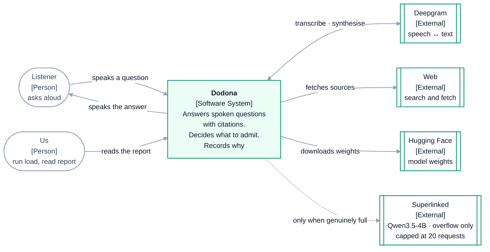
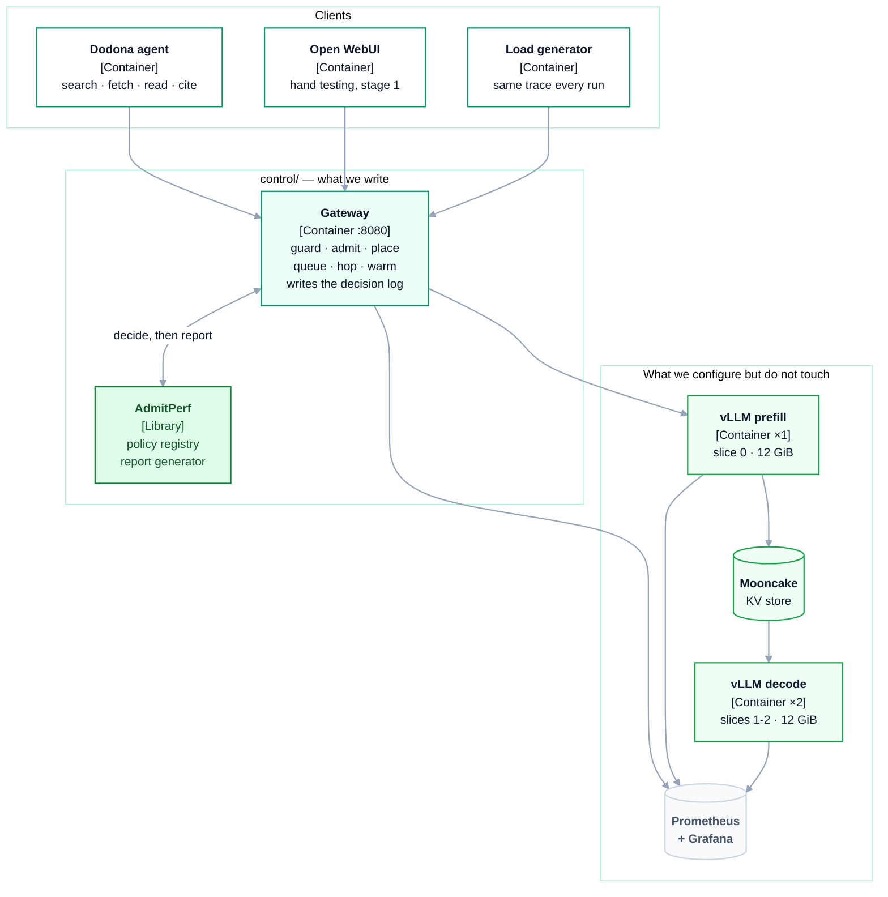
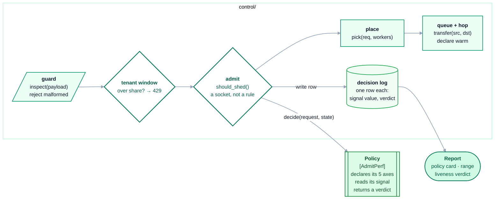

# The project

What Dodona is, the decisions behind it, and how the pieces fit. High level
first, then down.

- **This file** — the project, and the C4-style architecture levels.
- [`SUBMISSION.md`](SUBMISSION.md) — the cohort brief answered, part by part.
- [`docs/project/`](docs/README.md) — project deep dives: capacity arithmetic, per-part design, the run protocol.
- [`docs/cluster/`](docs/cluster/README.md) — cluster deep dives: the gateway, router, KV bus and observability, file by file.

---

## The problem

**You want to self-host a voice research agent on one GPU. The workload is
hostile to naive serving, and voice means the failure is audible.**

Three facts collide.

**The requests are enormous and uneven.** One fetched source is ~12,000 tokens,
arriving as a single prefill that holds 0.66 GiB of KV — a seventh of a worker's
cache for one caller. The turn before it was 1,040 tokens. Nothing about the
first turn tells you what the fourth will cost.

**There is one card.** An A100-40GB, split three ways, gives a decode pool of
**11 concurrent sequences** at full context. Not 11 users — 11 *sequences*. A
handful of simultaneous listeners saturates it.

**Someone is waiting out loud.** Latency is not a percentile in a dashboard; it
is dead air on a phone call. And one request carries two separate promises:
first audio inside a second, full answer in ten to thirty.

Put those together and the cluster is deciding what to let in, dozens of times a
minute. **Every deployment makes that decision — most make it by accident**, when
a queue fills and everything slows down together. The accident is the worst
version: it refuses nothing, serves everything badly, and tells you nothing about
why.

### So what has to exist

A control plane that makes the decision on purpose: **guard** malformed requests
at the door, **admit** or refuse on live engine state, **place** among replicas,
**queue** and **hop** KV between them, **declare** a replica warm before quoting
it, and decide what may **leave** for paid capacity.

And one thing more, because it is the part everyone skips: **a record of what the
policy actually saw.** A policy whose signal never reached its threshold is
indistinguishable, from the outside, from a policy that worked — same latencies,
same throughput, same dashboards. So every admission decision writes down the
value it read, and every run ends with a verdict on whether the thing could have
fired at all.

That is Dodona: the agent, the cluster under it, the control plane between them,
and a report that cannot quietly omit the number that matters.

---

## What we are building

**A voice research agent you can actually host, and the cluster that decides what
it is allowed to ask.**

You speak a question about herbs and supplements. Dodona searches, fetches
sources, reads them, and answers aloud with citations. Every token of inference
runs on **one A100-40GB you rent**. Deepgram does speech-to-text and
text-to-speech off-GPU; the GPU serves only the model.

Three things, connected:

| | |
|---|---|
| **The cluster** | Three vLLM workers on three HAMi slices of one card, split into a prefill pool and a decode pool with a KV hop between them, and Prometheus + Grafana over the whole thing |
| **The app** | A research agent on [AgentShip](https://github.com/Agent-Ship/agent-ship), with `agentship-voice` driving the speech loop |
| **The control plane** | Ours: guard, admit, place, queue, hop, declare warm, stay-or-leave. Admission is a plug-in socket filled by [AdmitPerf](https://github.com/harshuljain13/AdmitPerf) |

Built **stage by stage** — each stage ends with something testable before the
next begins. Nothing is inherited as a black box.

## Why a voice agent, and not a chatbot

The app choice drives everything downstream, so it comes first.

A chat workload is easy on a GPU: short prompts, short answers, uniform cost.
Nothing interesting happens at the door. A voice research agent is the opposite,
in four specific ways:

- **One turn is a very large prefill.** A fetched source is ~12,000 tokens, which
  is 0.66 GiB of KV — 14% of a worker's cache for a single request.
- **There is a big shared prefix.** System prompt plus tool schemas, ~1k tokens,
  byte-identical on every turn for every user. Prefix caching has real work to do
  and placement that ignores cache locality pays for it.
- **Context grows inside a session.** A request that was cheap on turn 1 is
  expensive by turn 4, so anything judging cost at arrival will admit sessions it
  cannot finish.
- **Tool calls leave gaps.** The agent goes quiet while a search or fetch runs,
  then comes back. Load is bursty because of how the app works, not because a
  generator was configured to make it so.

And voice adds the thing a text app does not have: **a real deadline**.

### Two SLOs on one request

```
listener speaks  ──►  "let me look that up"        time-to-first-audio   < 1 s
                 ──►  "...according to [source]"   time-to-full-answer   10-30 s
```

These are different promises on the same request, and they fail differently. Miss
the first and the interface feels broken — dead air. Miss the second and the
answer is merely late. **A request that cannot make its first-audio budget is
better refused aloud than admitted and left silent**, which is exactly the
decision the brief's `timeout_queue` shed is for.

It also makes warmth matter more than it does in text: a cold replica's first
token is *audible*. The ~1.8 s penalty of single-bucket CUDA-graph capture is
invisible in a chat box and glaring in a spoken turn.

Detail: [`docs/project/00-use-case.md`](docs/project/00-use-case.md).

## The decision the cluster has to make

With a decode pool of ~11 concurrent sequences and 12k-token prefills arriving,
the cluster is constantly deciding what to let in. Every LLM deployment does
this, whether or not anyone designed it — usually by accident, when a queue fills
up and everything slows down.

Four kinds of rule are available, and each has a blind spot:

| Watch | Refuse when |
|---|---|
| the memory | the KV cache is nearly full |
| the queue | too many are already waiting |
| the deadline | the work will not finish in time |
| the quota | a tenant is past their share |

Which one fits depends on hardware, model and traffic shape, so admission is a
**socket rather than a hardcoded check** — `ADMISSION_POLICY` selects one with no
code change. For Dodona the policy is `kv_threshold` at 0.90, chosen because the
capacity arithmetic says KV is what binds.

## What we measure

One question, and it is the one that tells you whether the control plane is doing
anything at all:

> **Does the signal the policy watches ever reach its threshold?**

If `kv_cache_utilization` never gets near 0.90, the policy was inert — it was
installed, it ran on every request, and it could not have changed a single
outcome. A cluster in that state looks identical to one with working admission
control, and nothing in the usual dashboards distinguishes them.

So every admission decision writes one row carrying **the signal value the policy
read**, and every run ends with a one-page report whose first line is that
verdict. AdmitPerf supplies both; we wire them in and run them against the fleet.

This is also why the model is a 7B and not a 3B, and why we did not quantize
further than forced. A fleet where nothing is ever scarce has no admission
decision to measure.

---

## Architecture

The [C4 model](https://c4model.com): the system from outside, then the pieces,
then inside the piece we write. The single high-level view is in
[`SUBMISSION.md`](SUBMISSION.md#high-level); these are the levels beneath it.

### Level 1 — Context



The dotted line is the only exit from the cluster and it is for capacity failures
alone. A tenant refusal stays local — a caller over their own quota being served
on capacity we pay for is overspending, not a capacity problem.

Deepgram is solid-line and external on purpose: speech is in the request path but
**off the GPU**, so it is a network constant rather than something competing for
SM time.

### Level 2 — Containers



**Open WebUI comes before the agent** — stage 1 points it straight at the engine
for hand testing, so a broken agent and a broken gateway are never confused for
each other. The load generator exists for the one thing it is good at: replaying
the *same* trace so two runs can be compared.

### Level 3 — Inside the gateway



Admission reads what the workers are doing, hands that plus the request to a
policy from the registry, does what comes back, and writes one row. The policy
declares its five axes at registration — unit, setting, objective, signal,
portability — so the report card fills itself in.

**The tenant window sits before admission**, and the ordering is load-bearing:
a quota refusal is client-attributable, so it is a 429, and a 429 must never
reach the paid overflow provider.

---

## The configuration, and the one decision that drove it

**1 × A100-40GB. `Qwen2.5-7B-Instruct-AWQ` at int4. TP=1, three HAMi slices of
12 GiB: one prefill and two decode. `max_model_len` 16,384.**

The hardware is the constraint everything derives from, and the binding fact is
that **A100 is sm80 and has no fp8 tensor cores**. So the usual "quantize the
weights to fp8, keep KV in fp16" move does not exist. int4 via AWQ is the only
thing that fits a 7B three ways on a 40 GiB card — it is the price of entry, not
an optimisation we chose.

```
kv_bytes_per_token = 2 x 28 layers x 4 kv_heads x 128 head_dim x 2 B = 56 KiB
per slice          = 12 x 0.90 = 10.80 GiB budget
                     - 5.20 weights - 0.80 runtime = 4.80 GiB KV
one 16k sequence   = 0.875 GiB
concurrency        = 4.80 / 0.875 = 5.5 seq/replica  ->  decode pool 11.0
max_num_seqs = 64  ->  KV binds, admission can bite
```

Full six-step decision chain, the rejected alternatives and the number that
rejected each:
[`SUBMISSION.md`](SUBMISSION.md#the-decision-chain) and
[`docs/project/01-capacity.md`](docs/project/01-capacity.md).

**Replication is what makes KV scarce.** Three copies of the weights cost
15.6 GiB of the 36 GiB allocated, leaving 14.4 GiB of KV across the fleet where a
single whole-card worker would have had 26.6 GiB. We pay 12.2 GiB of KV to have
three addressable workers — a placement decision and a hop. That is the central
trade of the design, and it is worth being explicit that it is a trade.

---

## Alternatives considered and rejected

Recorded because "why not the obvious production thing?" is a fair question.

| Alternative | Why not |
|---|---|
| **Envoy Gateway + llm-d router (EPP)** | The right production shape — Envoy at the edge for tenant token windows, `InferencePool` + ext_proc for placement, our code only for admission and the hop. It replaces Parts 3, 4 and 5 wholesale and is a multi-day build of new infrastructure. **The clear next version**, not this one |
| A CPU KV tier (LMCache, ~250 GiB host RAM) | Would relieve GPU KV scarcity entirely — and scarcity is the thing being studied. Also another component to bring up |
| GPU-hosted Whisper + TTS | Eats a slice and adds a stage whose latency is not what we are measuring. Deepgram keeps speech a network constant |
| Four GPUs, one worker per card | Not obtainable, and a module built on four cards is a result no cohort mate or workshop attendee could reproduce |
| A 3B model | Fits comfortably (pool ~15), but a materially weaker researcher, and the lab's 3B-at-2048 run is the canonical example of a fleet where nothing ever binds |

---

## Scope

**In:** one card, one model, one policy, one app. A live `/metrics` scrape, a
hop-or-warmup proof, a decision log, and a report.

**Out:** comparing policies and naming a winner (one cluster cannot support the
claim); multi-node anything; touching vLLM's scheduler; evaluating whether the
agent *researches well* (we need its traffic shape, not its accuracy); the SLM
multi-agent system; Envoy and llm-d.

---

## Risks

| Risk | Signal it happened | Response |
|---|---|---|
| **AWQ int4 does not load or is slow on sm80** | vLLM errors at load, or prefill throughput is far under estimate | Marlin int4 does support sm80, but verify at stage 0 before anything depends on it. Fallback is `Qwen2.5-3B` bf16 (pool ~15) with the arithmetic redone and said so |
| **5.2 GiB weights estimate is wrong** | `nvidia-smi` disagrees with the as-deployed table | AWQ leaves embeddings and `lm_head` in fp16 and Qwen2.5-7B does not tie them — that is 2.03 GiB of the 5.2. Measure at stage 0 |
| **A 12 GiB slice has less than 0.80 GiB of runtime headroom** | pod loads then refuses, or OOMs mid-run | This is the Part 1 step-3 trap at one remove. Widen the slices and drop to 2 pods if forced |
| **HAMi does not enforce the cap with 3 pods** | `nvidia-smi` shows a pod above its slice | The run is void until fixed. This is the integrity check |
| Pods start unequal | KV token counts differ between peers | Rolling, one-at-a-time start |
| Workers serve before warm | TTFT implausible on first requests | Warm, then re-quote. Audible as dead air in a voice turn |
| Mooncake hop slower than estimated | hop latency near the 4 s TCP figure rather than 0.5–0.8 s | Prediction P8. If it holds, the hop is slower than recomputing and Part 6's conclusion flips — which is a finding, not a failure |
| Tool schemas dropped at the worker boundary | the agent answers in prose, no `tool_calls` | A pass-through allowlist. Verified at stage 7, check 4 |
| **Signal inert** | report says `FAILED` | A result. Lead with it rather than apologising for it |

---

## Plan

Ten stages, each ending in something testable. Runbook:
[`RUNBOOK.md`](RUNBOOK.md). Status table:
[`README.md`](README.md#status).

The ordering has one deliberate feature worth naming: **observability (stage 3)
comes before the gateway (stage 4)**, because admission is a *function of* engine
metrics. There is nothing to decide on until the scrape exists.
