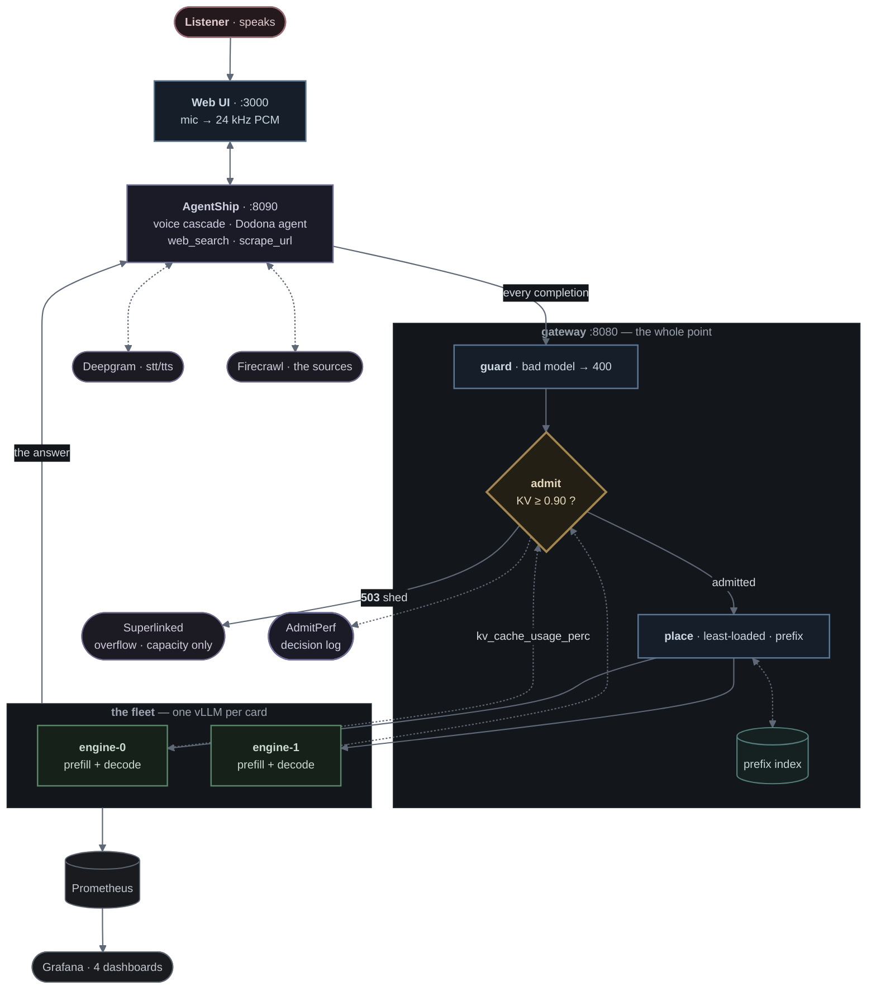

<p align="center">
  
</p>

<p align="center">
  <a href="https://github.com/vllm-project/vllm"></a>
  <a href="https://huggingface.co/Qwen/Qwen2.5-7B-Instruct-AWQ"></a>
  <a href="https://prometheus.io"></a>
  <a href="https://grafana.com"></a>
  <a href="https://github.com/harshuljain13/AdmitPerf"></a>
  <a href="https://github.com/Agent-Ship/agent-ship"></a>
  <a href="https://github.com/langchain-ai/langgraph"></a>
  <a href="https://deepgram.com"></a>
  <a href="https://superlinked.com"></a>
  
</p>

---

**Ask aloud. Dodona searches, reads the sources, and answers out loud with
citations — entirely on one GPU you rent.** No hosted chat API in the answer path.

The agent is the easy half. One fetched source arrives as a **12,000-token
prefill**, a rented box holds a fixed and knowable amount of KV, and a listener
is waiting out loud — so latency is dead air rather than a percentile. The
cluster has to decide what to let in, and most deployments make that decision by
accident, when a queue fills and everything slows together.

Dodona makes it on purpose, and writes down what it saw.

> *The oracle at Dodona answered questions by reading the sound of wind through
> the oak leaves.* Voice in, sourced answer out.

## Overview



**Reading it.** Blue is what we write · green is vLLM, configured not touched ·
indigo is a library we drive · teal is state · violet leaves this machine ·
grey is observability. **Amber is the decision** — one shape, one colour, and
the thing the whole project is about: `admit` reads `kv_cache_usage_perc`
straight off the engines and sheds at 0.90.

Thick edges are a request on its way to an answer. Dotted edges are something
being *told* rather than asked — a metric scraped, a prefix recorded, a
decision logged.

**Three ways out of the control plane, and the difference is the design.**
Admitted work goes to the GPU. A capacity refusal (`503`/`529`) reaches the
overflow gate and *may* leave for Superlinked. A tenant over quota gets `429`
and **never leaves** — paying a provider for a request we are refusing on our
own policy grounds is overspending, not a capacity event.

**One control loop, and it is the point of the project.** `admit` reads
`kv_cache_usage_perc` off the engines and **sheds** when it crosses 0.90,
storing the value it read next to the verdict. A refusal you can explain is
worth more than a queue that silently grows.

**Not autoscaling.** Scaling takes minutes to load weights; KV pressure moves in
seconds. That gap is the argument *for* admission control, and it is taught with
the number rather than demonstrated with a scaler that cannot win the race.
[`docs/PROJECT.md`](docs/PROJECT.md) has the reasoning.

```
2 × A100-80GB · one vLLM per card · data parallel · TP=1
Qwen2.5-32B-Instruct-AWQ (int4) · max_model_len 16,384
```

Both replicas serve both phases, so `place()` is choosing where work goes rather
than which phase goes where. The concurrency that follows depends on the card and
on `SLICE_MIB`, so it is measured rather than quoted — see
[`docs/project/01-capacity.md`](docs/project/01-capacity.md) for the arithmetic
and [`benchmarking/04-routing-admission/`](benchmarking/04-routing-admission/)
for the notebook that measures it on your box.

**The number that decides whether a run means anything.** The policy fires at
0.90 KV, so the KV pool has to be fillable by load you can actually generate.
Give a 32B the whole 80 GiB card and the pool is ~217k tokens — more than
`MAX_NUM_SEQS` can hold at once, so the signal never arrives and the run comes
back **INERT**: numbers indistinguishable from having no policy at all.
`SLICE_MIB` shrinks the pool until the threshold is reachable. Notebook 04
checks this before it generates any load, because it is the one mistake that
invalidates everything downstream.

### How it runs

```
make fleet-runpod            one vLLM per card, the gateway in front
make fleet-runpod-ssh        the tunnel — leave it open
make fleet-runpod-status     model, KV pressure, placement, uptime
make fleet-runpod-smoke-test does a request come back, with tools
make fleet-runpod-down       stop it
```

It runs in a **container**, which is what most rented GPUs are — so there is no
k3s, no HAMi and no KEDA on this branch, and nothing here needs systemd to be
PID 1.

### Other topologies live on their own branches

Each is a real variant with its own trade-offs, kept separate so that `main` is
one architecture explained honestly rather than four behind feature flags:

| branch | what it is |
|---|---|
| `main` | **this** — RunPod, data-parallel replicas, admission control and routing |
| [`lambda-cluster`](https://github.com/harshuljain13/Dodona/tree/lambda-cluster) | k3s + HAMi + KEDA on one card sliced three ways. Needs a host, not a container |
| [`lambda-pd-disaggregation`](https://github.com/harshuljain13/Dodona/tree/lambda-pd-disaggregation) | prefill/decode split with vLLM's KV connector. Needs RDMA to be worth it — see [`docs/project/topology.md`](docs/project/topology.md) |
| [`runpod-tp-cluster`](https://github.com/harshuljain13/Dodona/tree/runpod-tp-cluster) | one model sharded across cards with tensor parallel, for a model that will not fit on one |

Everything between the listener and the engines is the same on every branch —
the gateway, guard, admission policy, placement, queue, dashboards and reports.
What differs is how the workers get started and what enforces their memory.

## Documentation

| | |
|---|---|
| [**PREREQUISITES.md**](PREREQUISITES.md) | Accounts, keys, the SSH key and the GPU box — numbered steps, done once before `make fleet-runpod` |
| [**PROJECT.md**](docs/PROJECT.md) | The problem in full, the decision behind every choice, the C4 architecture levels, alternatives rejected, risks |
| [**SUBMISSION.md**](docs/SUBMISSION.md) | The design answered part by part, with a decision tree per part |
| [**COMMANDS.md**](docs/COMMANDS.md) | Every command in order, marked `[Mac]` or `[GPU]` |
| [**RUNBOOK.md**](docs/RUNBOOK.md) | The bring-up in order, the gate at each step, and what each failure actually means |
| [`docs/project/`](docs/README.md) | Capacity arithmetic, per-part depth, the run protocol, the results report |
| [`docs/cluster/`](docs/cluster/README.md) | The stack file by file — gateway, router, KV bus, observability |

```
app/                 the voice agent — talks only to our serve path
benchmarking/        everything that measures the cluster
  load.py            agent-shaped load; run it ON THE BOX, not over the tunnel
  locustfile.py      the Locust UI, for watching rather than measuring
  reports/           generated run reports
  notebook/          part5-queue.ipynb
infra/               everything that runs the cluster
  control/           guard · admit · place · queue · hop · warm · overflow
  cluster/           setup/, k8s/, observability/, kernels/
  metrics/           traces and load bundles
docs/
  PROJECT.md         the problem, every decision, the C4 levels
  SUBMISSION.md      the design answered part by part
  RUNBOOK.md         the bring-up in order, with a gate at each step
  COMMANDS.md        every command, marked [Mac] or [GPU]
  project/ cluster/  deep dives
tests/               22 test files
```

`infra/` runs the cluster, `docs/` explains it, `app/` is the agent. The repo
root holds this README and the Makefile, nothing else.

## Quick start

Needs **two NVIDIA cards** you can ssh to — two so that `place()` is choosing
between replicas rather than routing to the only one — and Python 3.11+ locally.
Accounts, keys and the box, in order, are
[**PREREQUISITES.md**](PREREQUISITES.md) — about twenty minutes, once.

```bash
git clone https://github.com/harshuljain13/Dodona.git && cd Dodona
cp .env.example .env     # set BOX, SSH_KEY, SSH_PORT — see PREREQUISITES.md
make doctor              # is .env complete?

make fleet-runpod        # ONE command: sync, install, start, tunnel
```

It syncs, installs vLLM, starts the fleet **detached** on the box, waits for
every component to answer, then opens the tunnel in your terminal. One command,
one terminal, and safe to re-run — it stops a running fleet first rather than
silently doing nothing. `make fleet-runpod-down` stops it,
`make fleet-runpod-logs` follows it.

**Four commands, and no more.** All run from your Mac and drive the box over
ssh — there is no separate login step.

| | |
|---|---|
| `make doctor` | **start here.** Is `.env` complete? Names every value and what its absence breaks, printing no secrets |
| `make fleet-runpod` | syncs, installs vLLM, starts one engine per card with the gateway in front, Prometheus and Grafana beside it, then opens the tunnel. Safe to re-run: it stops a running fleet first |
| `make app` | the voice app — the AgentShip service and the UI on `localhost:3000`. It reaches the GPU through the tunnel, so bring the fleet up first |
| `make test` | the control plane, locally, **with no GPU** |

Stopping, status, logs, the smoke test, load generation and the one-off tools
are in [COMMANDS.md](docs/COMMANDS.md).

When one step fails and you want to redo just that step, `make ssh` and then the
`box-*` targets — `box-setup`, `box-serve`, `box-gate`, `box-cluster`,
`box-observability`, `box-webui`, `box-smoke`. They refuse to run on a machine
with no NVIDIA device and tell you the Mac-side equivalent.

The gate is the part worth watching. Two of its four checks decide whether
anything else is worth doing — `config.json` must read 28 layers / 4 KV heads /
`head_dim` 128 (**P6**, = 56 KiB per token), and the weights on the card must
match the 5.20 GiB estimate. **Every concurrency number in the project is
derived from those two.** If either fails, redo the arithmetic before renting
more time.

→ Every command individually, and what each failure means:
[**COMMANDS.md**](docs/COMMANDS.md) · [**RUNBOOK.md**](docs/RUNBOOK.md)

## Status

**Nothing has run on hardware.** Every number here is *predicted*, and eight
predictions are written down to be checked later **without being edited**.

Stages **3** (a live `/metrics` scrape) and **8** (a hop or a warmup proof) are
the two that must exist. Observability comes before the gateway deliberately —
admission is a *function of* engine metrics, so there is nothing to decide on
until the scrape exists. Progress: [RUNBOOK.md](docs/RUNBOOK.md).

## Contributing

Three conventions carry most of the weight.

**Every number is marked predicted or measured**, and a prediction is never
edited to match what happened. One wrong by 2× tells you which piece of
arithmetic was misunderstood; one quietly retrofitted teaches nothing.

**One file owns each number.**
[`docs/project/01-capacity.md`](docs/project/01-capacity.md) is the authority —
everything else follows it, never the reverse.

**A claim needs an artifact.** "The policy fired" needs decision rows carrying
the signal value it read. "Placement is a choice" needs two replicas with
traffic on both. "Reuse saved a prefill" needs cached prompt tokens, not a
hit-rate gauge read once. No artifact means `TBM`.

**And a claim needs to be about this branch.** The honesty that cost the most
here: a prefill/decode split records a *decision* in a ledger, while moving the
bytes happens inside vLLM behind `--kv-transfer-config`. Miss that and the split
is worse than not splitting, because decode re-prefills and one answer costs two
prefills. `main` does not claim a hop, and
[`docs/project/topology.md`](docs/project/topology.md) works through why.

```bash
pytest tests/ && python3 -m compileall -q control tests
```

`.claude/skills/` holds five skills that load automatically in Claude Code —
`dodona-bringup`, `dodona-capacity`, `dodona-run`, `dodona-docs`, `dodona-review`.
They exist because this project has two characteristic ways of being wrong: a
number that no longer matches the hardware, and a claim no scrape supports.

## Built on

[vLLM](https://github.com/vllm-project/vllm) ·
[AdmitPerf](https://github.com/harshuljain13/AdmitPerf) ·
[AgentShip](https://github.com/Agent-Ship/agent-ship) ·
[Deepgram](https://deepgram.com) ·
[Lambda](https://lambdalabs.com) ·
[RunPod](https://runpod.io) ·
[llm-inference-experiments](https://github.com/harshuljain13/llm-inference-experiments)
