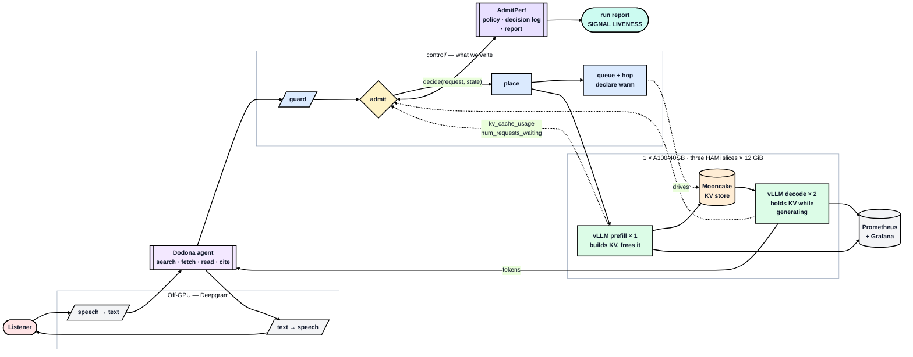

<p align="center">
  
</p>

<p align="center">
  <strong>A voice research agent you can actually host — and the cluster that decides what it is allowed to ask.</strong>
</p>

<p align="center">
  <a href="#quick-start">Quick start</a> ·
  <a href="#architecture">Architecture</a> ·
  <a href="#the-configuration">Configuration</a> ·
  <a href="SUBMISSION.md">Design</a> ·
  <a href="#contributing">Contributing</a>
</p>

<p align="center">
  
  
  
  
  
</p>

---

You speak a question about herbs and supplements. Dodona searches, fetches
sources, reads them, and answers aloud **with citations**. Every token of
inference runs on **one A100-40GB you rent** — no hosted chat API anywhere in the
answer path. Deepgram does speech-to-text and text-to-speech off-GPU; the GPU
serves only the model.

> The oracle at Dodona answered questions by interpreting the sound of wind
> through the oak leaves. Voice in, sourced answer out.

**Nothing here has run on hardware yet.** Every number below is marked
*predicted*, and eight predictions are written down to be checked without being
edited afterwards. See [Status](#status).

## Why this is a serving project, not an app project

The agent is the easy half. Three things about this workload make the control
plane the interesting part.

### Voice puts a real deadline on every request

```
listener speaks  ──►  "let me look that up"        time-to-first-audio   < 1 s
                 ──►  "...according to [source]"   time-to-full-answer   10-30 s
```

Two different promises on the same request, and they fail differently. Miss the
first and the interface feels broken — dead air. Miss the second and the answer
is merely late. **A request that cannot make its first-audio budget is better
refused aloud than admitted and left silent.**

It also makes warmth matter more than it does in text: a cold replica's first
token is *audible*. The ~1.8 s penalty of single-bucket CUDA-graph capture is
invisible in a chat box and glaring in a spoken turn.

### The workload is the hard serving shape

- **One turn is a very large prefill.** A fetched source is ~12,000 tokens =
  0.66 GiB of KV — 14% of a worker's cache for a single request.
- **There is a big shared prefix.** System prompt plus tool schemas, ~1k tokens,
  byte-identical every turn for every user. Prefix caching has real work to do,
  and placement that ignores cache locality pays for it.
- **Context grows inside a session.** A request that was cheap on turn 1 is
  expensive by turn 4 — so anything judging cost at arrival will admit sessions
  it cannot finish.
- **Tool calls leave gaps.** The agent goes quiet during a search or fetch. Load
  is bursty because of how the app works, not because a generator was told to
  make it so.

### The GPU is scarce by construction

One card, three slices, a decode pool of **11 concurrent sequences** at
`max_model_len`. The cluster genuinely has to turn work away — which is the
premise worth building a control plane for.

## The decision the cluster has to make

Every LLM deployment does admission control, whether or not anyone designed it —
usually by accident, when a queue fills up and everything slows down. Four kinds
of rule are available, and each has a blind spot:

| Watch | Refuse when |
|---|---|
| the memory | the KV cache is nearly full |
| the queue | too many are already waiting |
| the deadline | the work will not finish in time |
| the quota | a tenant is past their share |

Which one fits depends on hardware, model and traffic shape, so admission is a
**socket rather than a hardcoded check** — `ADMISSION_POLICY` selects one with no
code change. Dodona runs `kv_threshold` at 0.90, because the arithmetic says KV
is what binds.

### What we measure

> **Does the signal the policy watches ever reach its threshold?**

If `kv_cache_utilization` never gets near 0.90, the policy was **inert** — it was
installed, it ran on every request, and it could not have changed a single
outcome. A cluster in that state looks identical to one with working admission
control, and nothing in the usual dashboards distinguishes them.

So every admission decision writes one row carrying **the signal value the policy
read**, and every run ends with a one-page report whose first line is that
verdict. [AdmitPerf](https://github.com/harshuljain13/AdmitPerf) supplies both.

This is also why the model is a 7B and not a 3B, and why we did not quantize
further than forced: a fleet where nothing is ever scarce has no admission
decision to measure.

## Architecture

Three boxes — the app, the control plane we write, the engine we configure. The
C4 levels (context, containers, inside the gateway) are in
[`docs/project/architecture.md`](docs/project/architecture.md).



The dotted lines are the ones that matter: admission reads engine state, so the
policy's verdict depends on what the workers are actually doing — and the value
it read is written down next to the verdict.

Deepgram sits outside the GPU box on purpose. Speech is in the request path but
**off the GPU**, so it is a network constant rather than something competing for
SM time.

## The configuration

**1 × A100-40GB. `Qwen2.5-7B-Instruct-AWQ` at int4. TP=1, three HAMi slices of
12 GiB: one prefill and two decode. `max_model_len` 16,384.**

```
kv_bytes_per_token = 2 x 28 layers x 4 kv_heads x 128 head_dim x 2 B = 56 KiB
per slice          = 12 x 0.90 = 10.80 GiB budget      <- 0.90 of the SLICE
                     - 5.20 weights - 0.80 runtime     =  4.80 GiB KV
one 16k sequence   = 0.875 GiB
concurrency        = 4.80 / 0.875 = 5.5 seq/replica  ->  decode pool 11.0
max_num_seqs = 64  ->  KV binds, admission can bite
```

Three things in that arithmetic are the load-bearing concepts:

- **`gpu_memory_utilization` applies to the slice, not the card.** HAMi gives the
  pod a hard `gpumem` cap it sees as its entire device. Reading 0.90 against the
  40 GiB card inflates KV by **3×**.
- **int4 is forced, not chosen.** The A100 is sm80 and has no fp8 tensor cores,
  so this is the only way a 7B fits three ways on 40 GiB. On a bigger card we
  would have *declined* to quantize — freeing memory triples concurrency and
  leaves nothing for admission to bind on. Same technique, opposite verdict,
  because the constraint moved.
- **Replication costs 12.2 GiB of KV.** Three copies of the weights take 15.6 of
  the 36 GiB allocated, leaving 14.4 GiB of cache where one whole-card worker
  would have had 26.6. That buys three addressable workers — a placement decision
  and a hop — and it is a trade, not a free structural win. It is also the honest
  answer to "the cache is full, add a replica": a replica *removes* 5.2 GiB from
  fleet KV.

Full six-step decision chain, with every rejected alternative and the number that
rejected it: [`docs/project/01-capacity.md`](docs/project/01-capacity.md).

## Quick start

### Prerequisites

| | |
|---|---|
| GPU | 1 × A100-40GB (sm80). Any ≥40 GiB NVIDIA card works if you redo the arithmetic |
| Host | Docker with the NVIDIA container runtime. k3s + HAMi from stage 2 onward |
| Python | 3.11+ for the control plane and tests |
| Keys | Deepgram (voice), and Superlinked if you want the overflow path live |

### Set up

```bash
git clone https://github.com/harshuljain13/Dodona.git && cd Dodona
cp .env.example .env          # then fill in LAMBDA, model, worker URLs, keys
python3 -m venv .venv && source .venv/bin/activate
pip install -r cluster/requirements.txt
pytest tests/
```

`.env` is gitignored and must never be committed. Every value in
[`.env.example`](.env.example) carries the reason it is set that way.

### Bring the cluster up

[`cluster/RUNBOOK.md`](cluster/RUNBOOK.md) is what you execute — ten stages, each
with a gate you check before starting the next. **Stage 0 needs no Kubernetes at
all**, which is deliberate: the capacity arithmetic gets verified before any
orchestration exists.

```bash
docker run --gpus all -p 8000:8000 vllm/vllm-openai:latest \
  --model Qwen/Qwen2.5-7B-Instruct-AWQ \
  --quantization awq_marlin \
  --max-model-len 16384 --max-num-seqs 64 \
  --gpu-memory-utilization 0.90 --enable-prefix-caching \
  --enable-auto-tool-choice --tool-call-parser hermes
```

Stage 0's gate is four checks, and two of them decide whether anything else is
worth doing:

| | Check | Expect |
|---|---|---|
| 0a | `curl localhost:8000/v1/chat/completions` | 200, text back |
| 0b | `curl localhost:8000/metrics \| grep kv_cache` | `vllm:gpu_cache_usage_perc` present |
| **0c** | **`config.json`: layers / `num_key_value_heads` / `head_dim`** | **28 / 4 / 128 → 56 KiB per token** |
| **0d** | `nvidia-smi` memory used vs the 5.20 GiB estimate | within ~10% |

If 0c or 0d disagree, stop and redo the arithmetic before renting more time —
every concurrency figure in the project moves with them.

## Layout

Three documents at the top, then one directory per thing that actually runs.

```
Dodona/
  README.md · SUBMISSION.md

  app/                 the Dodona voice agent — talks only to our serve path
  control/             the control plane. Import root for three packages:
    gateway/             guard · admit · place · the AdmitPerf socket
    router/              pools · placement · KV bus · Mooncake · warmup · eviction
    edge/                guardrails and the load harnesses
  cluster/
    RUNBOOK.md           the bring-up, stage 0 -> 10, with a gate each
    k8s/                 HAMi slices, Mooncake, observability, Open WebUI
    setup/               Lambda bring-up, the SSH tunnel, smoke tests
    observability/       dashboard definitions
    kernels/             attention HBM math, eviction, warmup tooling
  docs/
    project/             architecture, capacity, per-part depth, results report
    cluster/             the stack, file by file
  tests/               22 test files
  notebook/            part5-queue.ipynb
  metrics/             scrapes, decision logs, reports
  assets/screenshots/  Grafana exhibits and generated charts
```

| Document | For |
|---|---|
| **`README.md`** | What this is, how to run it — you are here |
| [**`SUBMISSION.md`**](SUBMISSION.md) | **The design**, answered part by part with a decision tree per part |
| [`docs/project/`](docs/README.md) | Depth: architecture, capacity arithmetic, the run protocol |
| [`docs/cluster/`](docs/cluster/README.md) | The stack, file by file — gateway, router, KV bus, observability |

`control/` is the import root: `gateway`, `router` and `edge` import each other
and are carried over intact from the class-10 lab. `edge` is that lab's `app`
package renamed, so the top-level `app/` is unambiguously ours.

## Status

| # | Stage | Gate | State |
|---|---|---|---|
| 0 | vLLM on the bare box | `kv_bytes_per_token` verified against `config.json` | not started |
| 1 | Open WebUI | you talk to it in a browser | not started |
| 2 | k3s + HAMi, 3 slices | `nvidia-smi`: 3 processes on index 0, none over its cap | not started |
| 3 | Prometheus + Grafana | **a live `/metrics` scrape** | not started |
| 4 | Gateway, pass-through | traffic flows through our box | not started |
| 5 | Guardrails + tenant window | 400 and 429 without touching a GPU | not started |
| 6 | Admission as a socket | `decisions.jsonl` carries the signal value | not started |
| 7 | Placement | requests spread by score, not round-robin | not started |
| 8 | KV hop + warm gate | **a recorded hop, or a cold-vs-warm re-quote** | not started |
| 9 | The voice agent | a cited answer, every completion through the serve path | not started |
| 10 | Measure | run bundles, baselines, report | not started |

Stages 3 and 8 are the two that have to exist. Stage 3 before stage 4 is
deliberate: admission is a *function of* engine metrics, so there is nothing to
decide on until the scrape exists.

## Alternatives considered and rejected

Recorded because "why not the obvious production thing?" is a fair question.

| Alternative | Why not |
|---|---|
| **Envoy Gateway + llm-d router (EPP)** | The right production shape — Envoy at the edge for tenant token windows, `InferencePool` + ext_proc for placement, our code only for admission and the hop. It replaces three of the six decisions wholesale and is a multi-day build of new infrastructure. **The clear next version**, not this one |
| A CPU KV tier (LMCache, ~250 GiB host RAM) | Would relieve GPU KV scarcity entirely — and scarcity is the thing being studied |
| GPU-hosted Whisper + TTS | Eats a slice and adds a stage whose latency is not what we are measuring. Deepgram keeps speech a network constant |
| Four GPUs, one worker per card | Not obtainable, and a result on four cards is one nobody else could reproduce |
| A 3B model | Fits comfortably (pool ~15) but a materially weaker researcher — and the lab's 3B-at-2048 run is the canonical fleet where nothing ever binds |
| A 32B model | 18.1 GiB at int4 will not fit a 12 GiB slice. Reachable only at two pods, which costs the placement decision |

## Risks

| Risk | Signal it happened | Response |
|---|---|---|
| **AWQ int4 slow or broken on sm80** | vLLM errors at load, or prefill throughput far under estimate | Marlin int4 does support sm80 — verify at stage 0. Fallback is `Qwen2.5-3B` bf16 with the arithmetic redone and said so |
| **A 12 GiB slice has under 0.80 GiB of runtime headroom** | pod loads then refuses, or OOMs mid-run | The Part 1 step-3 trap at one remove. Widen slices, drop to two pods if forced |
| **HAMi not enforcing the cap** | `nvidia-smi` shows a pod above its slice | The run is void until fixed. This is the integrity check |
| Pods start unequal | KV token counts differ between peers | Rolling, one-at-a-time start |
| Workers serve before warm | TTFT implausible on first requests | Warm, then re-quote. Audible as dead air in a voice turn |
| Hop slower than estimated | hop latency near the 4 s TCP figure, not 0.5–0.8 s | Prediction P8. If it holds, the hop is slower than recomputing and the conclusion flips — a finding, not a failure |
| Tool schemas dropped at the worker boundary | agent answers in prose, no `tool_calls` | The payload is an allowlist. Verified at stage 9 |
| **Signal inert** | report says `FAILED` | A result. Lead with it rather than apologising for it |

## Contributing

### The conventions that matter

**Every number is marked predicted or measured.** Predictions are written down
*before* a run and checked afterwards — **they are never edited to match what
happened**. A prediction wrong by 2× tells the reader which piece of arithmetic
was misunderstood; one silently retrofitted teaches nothing. `TBM` means
to-be-measured, and a `TBM` in the final report is a hole we are disclosing.

**One file owns each number.**
[`docs/project/01-capacity.md`](docs/project/01-capacity.md) is the authority;
`SUBMISSION.md` and `README.md` follow it, never the reverse.

**A claim needs an artifact.** "The policy fired" needs `decisions.jsonl` rows
with a signal value. "The hop works" needs a non-empty `/hops` *and*
`KV_BACKEND=mooncake` confirmed. "TTFT is X" needs vLLM's metrics from a warm
replica. No artifact means `TBM`.

### Before opening a PR

```bash
pytest tests/
python3 -m compileall -q control tests          # everything imports
```

Check every link and anchor still resolves — the `dodona-docs` skill carries the
validator. Then update the [Status](#status) table against the tree rather than
against your diff.

### Project skills

`.claude/skills/` holds five skills that load automatically in Claude Code. They
exist because this project has two characteristic ways of being wrong — **a
number that no longer matches the hardware, and a claim no scrape supports** —
and each skill is aimed at one of them.

| Skill | Use when |
|---|---|
| `dodona-stage` | Bringing up or debugging a stage |
| `dodona-capacity` | A knob moved and the arithmetic needs redoing |
| `dodona-run` | Running an experiment, or reading one |
| `dodona-docs` | A number changed and the docs must stop disagreeing |
| `dodona-review` | Reviewing a diff, or before calling anything done |

### Scope

**In:** one card, one model, one policy, one app. A live `/metrics` scrape, a
hop-or-warmup proof, a decision log, a report.

**Out:** comparing policies and naming a winner (one cluster cannot support the
claim); multi-node anything; touching vLLM's scheduler; evaluating whether the
agent *researches well* — we need its traffic shape, not its accuracy.

## Prior art this builds on

| | |
|---|---|
| [AdmitPerf](https://github.com/harshuljain13/AdmitPerf) | The policy registry, the per-decision log, the report generator |
| [AgentShip](https://github.com/Agent-Ship/agent-ship) | The agent framework, and `agentship-voice` for the speech loop |
| [llm-inference-experiments](https://github.com/harshuljain13/llm-inference-experiments) | Modules 1–10. The class-10 lab is where this cluster's shape comes from |
| [vLLM](https://github.com/vllm-project/vllm) · [HAMi](https://github.com/Project-HAMi/HAMi) · [Mooncake](https://github.com/kvcache-ai/Mooncake) | The engine, the slicing, the KV transport |
