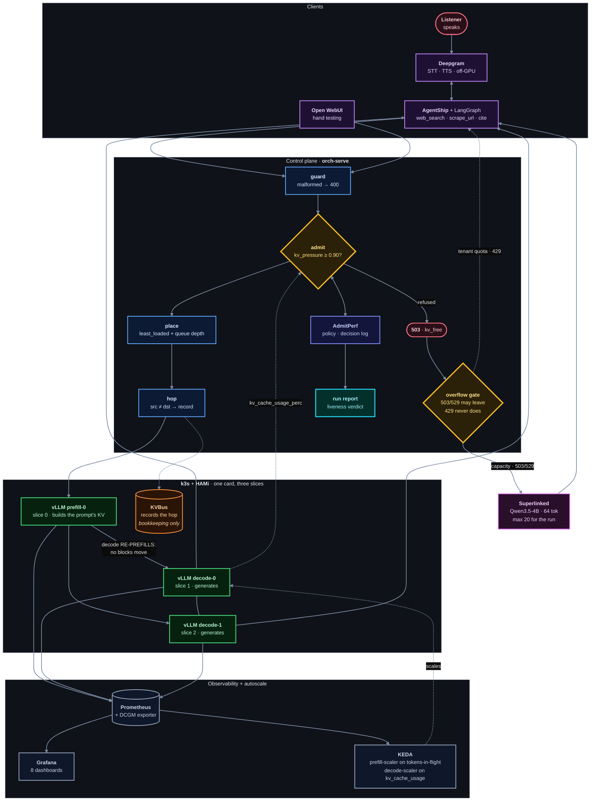

<p align="center">
  
</p>

<p align="center">
  <a href="https://github.com/vllm-project/vllm"></a>
  <a href="https://huggingface.co/Qwen/Qwen2.5-7B-Instruct-AWQ"></a>
  <a href="https://github.com/Project-HAMi/HAMi"></a>
  <a href="https://github.com/kvcache-ai/Mooncake"></a>
  <a href="https://k3s.io"></a>
  <a href="https://prometheus.io"></a>
  <a href="https://grafana.com"></a>
  <a href="https://github.com/harshuljain13/AdmitPerf"></a>
  <a href="https://github.com/Agent-Ship/agent-ship"></a>
  <a href="https://github.com/langchain-ai/langgraph"></a>
  <a href="https://deepgram.com"></a>
  <a href="https://superlinked.com"></a>
  <a href="https://lambdalabs.com"></a>
  
</p>

---

**Ask aloud. Dodona searches, reads the sources, and answers out loud with
citations — entirely on one GPU you rent.** No hosted chat API in the answer path.

The agent is the easy half. One fetched source arrives as a **12,000-token
prefill**, a single card split three ways serves only a handful of concurrent
sequences, and a listener is waiting out loud — so latency is dead air rather
than a percentile. The cluster has to decide what to let in —
and most deployments make that decision by accident, when a queue fills and
everything slows together.

Dodona makes it on purpose, and writes down what it saw.

> *The oracle at Dodona answered questions by reading the sound of wind through
> the oak leaves.* Voice in, sourced answer out.

## Overview



🔵 what we write · 🟢 vLLM, configured not touched · 🟠 KV storage ·
🟡 a decision · 🟣 clients and external services · ⚪ observability · 🔴 a refusal

**Three ways out of the control plane, and the difference is the design.**
Admitted work goes to the GPU. A capacity refusal (`503`/`529`) reaches the
overflow gate and *may* leave for Superlinked. A tenant over quota gets `429`
and **never leaves** — paying a provider for a request we are refusing on our
own policy grounds is overspending, not a capacity event.

**Two control loops, both dashed, both reading the same number.** `admit` takes
`kv_cache_usage_perc` straight off decode and **sheds** when it crosses 0.90 —
storing the value it read next to the verdict, which is the whole point. KEDA
takes the same metric through Prometheus and **scales** instead. Same signal,
opposite response.

The fleet stays at three pods for any measured run: a fleet that resizes
mid-comparison means the deployment moved, not the policy. KEDA is wired and
left at `min 1 · max 2` so the mechanism is real and visible.

```
1 × NVIDIA GPU · 3 HAMi slices · 1 prefill + 2 decode · TP=1
Qwen2.5-7B-Instruct-AWQ (int4) · max_model_len 16,384
```

The concurrency that follows depends on the card, so it is measured rather than
quoted. `make cluster` prints it, and the arithmetic is in
[`docs/project/01-capacity.md`](docs/project/01-capacity.md).

Measured on 1 × A100-40GB with 12 GiB slices: **4.80 GiB of KV per worker, 5.5
sequences each, decode pool 11.** On any other card these change, and nothing
in this repo hardcodes them.

## Documentation

| | |
|---|---|
| [**PROJECT.md**](docs/PROJECT.md) | The problem in full, the decision behind every choice, the C4 architecture levels, alternatives rejected, risks |
| [**SUBMISSION.md**](docs/SUBMISSION.md) | The design answered part by part, with a decision tree per part |
| [**COMMANDS.md**](docs/COMMANDS.md) | Every command in order, marked `[Mac]` or `[GPU]` |
| [**RUNBOOK.md**](docs/RUNBOOK.md) | The bring-up in order, the gate at each step, and what each failure actually means |
| [`docs/project/`](docs/README.md) | Capacity arithmetic, per-part depth, the run protocol, the results report |
| [`docs/cluster/`](docs/cluster/README.md) | The stack file by file — gateway, router, KV bus, observability |

```
app/                 the voice agent — talks only to our serve path
infra/
  control/           guard · admit · place · queue · hop · warm · stay-or-leave
  cluster/           how the fleet comes up: setup/, k8s/, observability/
  metrics/           traces and load-generator bundles
  reports/           generated run reports
  notebook/          part5-queue.ipynb
docs/
  PROJECT.md         the problem, every decision, the C4 levels
  SUBMISSION.md      the design answered part by part
  RUNBOOK.md         the bring-up in order, with a gate at each step
  COMMANDS.md        every command, marked [Mac] or [GPU]
  project/ cluster/  deep dives
tests/               22 test files
```

`infra/` runs the cluster, `docs/` explains it, `app/` is the agent. The repo
root holds this README and the Makefile, nothing else.

## Quick start

Needs an NVIDIA card you can ssh to, and Python 3.11+ locally.

```bash
git clone https://github.com/harshuljain13/Dodona.git && cd Dodona
cp .env.example .env     # set BOX and SSH_KEY
make cluster && make observability && make ssh
```

Then open **http://127.0.0.1:3000** and talk to it.

**Four commands, and no more.** All run from your Mac and drive the box over
ssh — there is no separate login step.

| | |
|---|---|
| `make cluster` | syncs the project, then k3s + HAMi + KEDA, **1 prefill + 2 decode** across three slices, the gateway in front of them, and **the capacity checks against a running pod** |
| `make observability` | Prometheus + Grafana + DCGM |
| `make ssh` | the tunnel. Leave it open — every URL below is `127.0.0.1` |
| `make test` | the control plane, locally, **with no GPU** |

Both bring-up targets are safe to re-run. Stopping, logs, load generation and
the one-off tools are plain commands in [COMMANDS.md](docs/COMMANDS.md).

When one step fails and you want to redo just that step, `make ssh` and then the
`box-*` targets — `box-setup`, `box-serve`, `box-gate`, `box-cluster`,
`box-observability`, `box-webui`, `box-smoke`. They refuse to run on a machine
with no NVIDIA device and tell you the Mac-side equivalent.

The gate is the part worth watching. Two of its four checks decide whether
anything else is worth doing — `config.json` must read 28 layers / 4 KV heads /
`head_dim` 128 (**P6**, = 56 KiB per token), and the weights on the card must
match the 5.20 GiB estimate. **Every concurrency number in the project is
derived from those two.** If either fails, redo the arithmetic before renting
more time.

→ Every command individually, and what each failure means:
[**COMMANDS.md**](docs/COMMANDS.md) · [**RUNBOOK.md**](docs/RUNBOOK.md)

## Status

**Nothing has run on hardware.** Every number here is *predicted*, and eight
predictions are written down to be checked later **without being edited**.

Stages **3** (a live `/metrics` scrape) and **8** (a hop or a warmup proof) are
the two that must exist. Observability comes before the gateway deliberately —
admission is a *function of* engine metrics, so there is nothing to decide on
until the scrape exists. Progress: [RUNBOOK.md](docs/RUNBOOK.md).

## Contributing

Three conventions carry most of the weight.

**Every number is marked predicted or measured**, and a prediction is never
edited to match what happened. One wrong by 2× tells you which piece of
arithmetic was misunderstood; one quietly retrofitted teaches nothing.

**One file owns each number.**
[`docs/project/01-capacity.md`](docs/project/01-capacity.md) is the authority —
everything else follows it, never the reverse.

**A claim needs an artifact.** "The policy fired" needs decision rows carrying a
signal value. "The hop works" needs a non-empty `/hops` *and*
`KV_BACKEND=mooncake` confirmed. No artifact means `TBM`.

```bash
pytest tests/ && python3 -m compileall -q control tests
```

`.claude/skills/` holds five skills that load automatically in Claude Code —
`dodona-bringup`, `dodona-capacity`, `dodona-run`, `dodona-docs`, `dodona-review`.
They exist because this project has two characteristic ways of being wrong: a
number that no longer matches the hardware, and a claim no scrape supports.

## Built on

[vLLM](https://github.com/vllm-project/vllm) ·
[HAMi](https://github.com/Project-HAMi/HAMi) ·
[Mooncake](https://github.com/kvcache-ai/Mooncake) ·
[AdmitPerf](https://github.com/harshuljain13/AdmitPerf) ·
[AgentShip](https://github.com/Agent-Ship/agent-ship) ·
[Deepgram](https://deepgram.com) ·
[Lambda](https://lambdalabs.com) ·
[llm-inference-experiments](https://github.com/harshuljain13/llm-inference-experiments)
