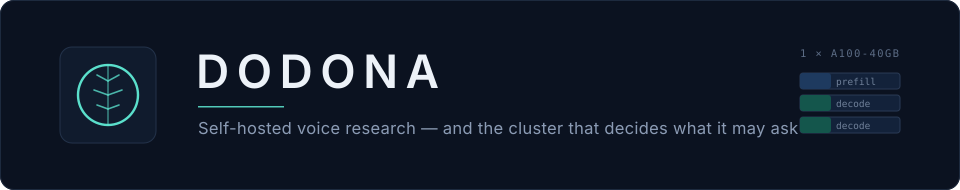
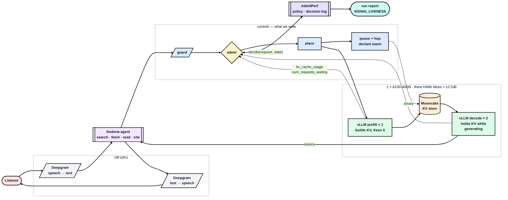

<p align="center">
  
</p>

<p align="center">
  <a href="#the-problem">Problem</a> ·
  <a href="#how-it-works">How it works</a> ·
  <a href="#quick-start">Quick start</a> ·
  <a href="PROJECT.md">Project</a> ·
  <a href="SUBMISSION.md">Design</a>
</p>

<p align="center">
  
  
  
  
  
</p>

---

Ask aloud. Dodona searches, fetches sources, reads them, and **answers out loud
with citations** — entirely on one GPU you rent. No hosted chat API in the answer
path.

> The oracle at Dodona answered questions by reading the sound of wind through
> the oak leaves. Voice in, sourced answer out.

## The problem

**Self-hosting a voice research agent on one GPU is hard in a specific way, and
voice makes the failure audible.**

| | |
|---|---|
| **The requests are enormous and uneven** | One fetched source is ~12,000 tokens — 0.66 GiB of KV, a seventh of a worker's cache, for one caller. The turn before it was 1,040 tokens. Nothing about turn 1 tells you what turn 4 will cost |
| **There is one card** | An A100-40GB split three ways gives a decode pool of **11 concurrent sequences**. Not 11 users — 11 *sequences*. A handful of listeners saturates it |
| **Someone is waiting out loud** | Latency is dead air, not a percentile. And one request carries two promises: first audio inside a second, full answer in ten to thirty |

So the cluster is deciding what to let in, dozens of times a minute. **Every
deployment makes that decision — most make it by accident**, when a queue fills
and everything slows together. That accident refuses nothing, serves everything
badly, and tells you nothing about why.

**Dodona makes the decision on purpose, and writes down what it saw.**

Because a policy whose signal never reached its threshold is indistinguishable
from one that worked — same latencies, same dashboards. So every admission
decision records the value it read, and every run ends with a verdict on whether
the policy could have fired at all.

→ The problem in full, and the decisions it forces: [**`PROJECT.md`**](PROJECT.md)

## How it works



The dotted lines are the point: admission reads engine state, so the verdict
depends on what the workers are actually doing — and the value it read is stored
beside the verdict.

## The configuration

```
1 × A100-40GB · Qwen2.5-7B-Instruct-AWQ (int4) · TP=1
3 HAMi slices × 12 GiB · 1 prefill + 2 decode · max_model_len 16,384

kv_bytes_per_token = 2 × 28 layers × 4 kv_heads × 128 head_dim × 2 B = 56 KiB
per slice          = 12 × 0.90 − 5.20 weights − 0.80 runtime = 4.80 GiB KV
one 16k sequence   = 0.875 GiB  →  5.5 seq/replica  →  decode pool 11.0
max_num_seqs = 64  →  KV binds
```

**int4 is forced, not chosen** — the A100 is sm80 and has no fp8 tensor cores, so
it is the only way a 7B fits three ways on 40 GiB. On a bigger card we would have
*declined* to quantize: freeing memory triples concurrency and leaves nothing for
admission to bind on.

→ The six-step chain and every rejected alternative:
[`docs/project/01-capacity.md`](docs/project/01-capacity.md)

## Quick start

Needs a ≥40 GiB NVIDIA card, Docker with the NVIDIA runtime, and Python 3.11+.

```bash
git clone https://github.com/harshuljain13/Dodona.git && cd Dodona
cp .env.example .env            # fill in host, model, worker URLs, keys
python3 -m venv .venv && source .venv/bin/activate
pip install -r cluster/requirements.txt
pytest tests/
```

Then **stage 0** — no Kubernetes, one container, the whole card:

```bash
docker run -d --gpus all --ipc=host -p 8000:8000 vllm/vllm-openai:latest \
  --model Qwen/Qwen2.5-7B-Instruct-AWQ \
  --max-model-len 16384 --max-num-seqs 64 --gpu-memory-utilization 0.90
```

Four flags, all of them in the capacity arithmetic. Tool-calling flags arrive at
stage 9 with the agent — they buy nothing before there is a tool to call.

Its gate is four checks. Two of them decide whether anything else is worth doing:
**`config.json` must read 28 layers / 4 KV heads / `head_dim` 128** (= 56 KiB per
token), and **`nvidia-smi` must agree with the 5.20 GiB weights estimate.** If
either is off, redo the arithmetic before renting more time.

→ Every command in order: [**`COMMANDS.md`**](COMMANDS.md)
→ All ten stages and their gates: [`RUNBOOK.md`](RUNBOOK.md)

## Where to read what

| | |
|---|---|
| [**`PROJECT.md`**](PROJECT.md) | The problem in full, the decisions, the C4 architecture levels, alternatives rejected, risks |
| [**`SUBMISSION.md`**](SUBMISSION.md) | The design answered part by part, with a decision tree per part |
| [`docs/project/`](docs/README.md) | Capacity arithmetic, per-part depth, the run protocol, the results report |
| [`docs/cluster/`](docs/cluster/README.md) | The stack file by file — gateway, router, KV bus, observability |
| [`COMMANDS.md`](COMMANDS.md) | **Every command, in order**, marked `[Mac]` or `[GPU]` |
| [`RUNBOOK.md`](RUNBOOK.md) | The ten stages, their gates, and what each failure actually means |

```
app/        the voice agent — talks only to our serve path
control/    guard · admit · place · queue · hop · warm · stay-or-leave
cluster/    how the engine comes up
tests/      22 test files
notebook/   part5-queue.ipynb
metrics/    scrapes, decision logs, reports
assets/     logo, Grafana exhibits, charts
```

`control/` is the import root for three packages — `gateway`, `router`, `edge` —
carried over intact from the class-10 lab.

## Status

**Nothing has run on hardware.** Every number above is *predicted*, and eight
predictions are recorded to be checked later **without being edited**.

| Stage | | Stage | |
|---|---|---|---|
| 0 vLLM on the bare box | ○ | 6 Admission as a socket | ○ |
| 1 Open WebUI | ○ | 7 Placement | ○ |
| 2 k3s + HAMi, 3 slices | ○ | 8 KV hop + warm gate | ○ |
| 3 Prometheus + Grafana | ○ | 9 The voice agent | ○ |
| 4 Gateway, pass-through | ○ | 10 Measure | ○ |
| 5 Guardrails + tenant window | ○ | | |

Stages **3** and **8** are the two that have to exist — a live `/metrics` scrape,
and a hop or a warmup proof. Stage 3 precedes the gateway deliberately: admission
is a *function of* engine metrics, so there is nothing to decide on until the
scrape exists.

## Contributing

Three conventions carry most of the weight:

- **Every number is marked predicted or measured**, and a prediction is never
  edited to match what happened. One wrong by 2× tells you which piece of
  arithmetic was misunderstood; one retrofitted teaches nothing.
- **One file owns each number.**
  [`docs/project/01-capacity.md`](docs/project/01-capacity.md) is the authority.
- **A claim needs an artifact.** "The policy fired" needs decision rows with a
  signal value. "The hop works" needs a non-empty `/hops` *and*
  `KV_BACKEND=mooncake`. No artifact means `TBM`.

```bash
pytest tests/ && python3 -m compileall -q control tests
```

`.claude/skills/` holds five skills that load automatically in Claude Code —
`dodona-stage`, `dodona-capacity`, `dodona-run`, `dodona-docs`, `dodona-review`.
They exist because this project has two characteristic ways of being wrong: a
number that no longer matches the hardware, and a claim no scrape supports.

## Built on

[AdmitPerf](https://github.com/harshuljain13/AdmitPerf) (policies, decision log,
report) · [AgentShip](https://github.com/Agent-Ship/agent-ship) (the agent and
its voice loop) ·
[llm-inference-experiments](https://github.com/harshuljain13/llm-inference-experiments)
(modules 1–10, where this cluster's shape comes from) ·
[vLLM](https://github.com/vllm-project/vllm) ·
[HAMi](https://github.com/Project-HAMi/HAMi) ·
[Mooncake](https://github.com/kvcache-ai/Mooncake)
