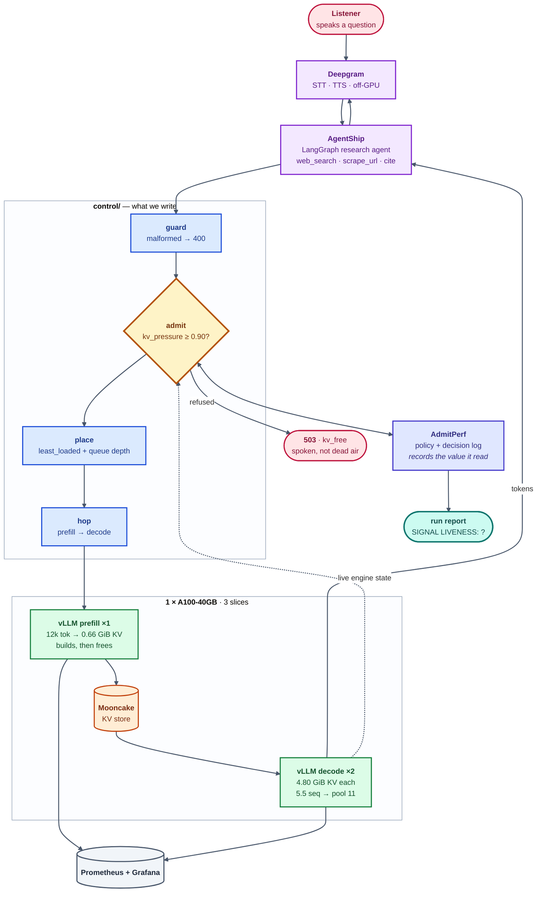

<p align="center">
  
</p>

<p align="center">
  <a href="https://github.com/vllm-project/vllm"></a>
  <a href="https://huggingface.co/Qwen/Qwen2.5-7B-Instruct-AWQ"></a>
  <a href="https://github.com/Project-HAMi/HAMi"></a>
  <a href="https://github.com/kvcache-ai/Mooncake"></a>
  <a href="https://k3s.io"></a>
  <a href="https://prometheus.io"></a>
  <a href="https://grafana.com"></a>
  <a href="https://github.com/harshuljain13/AdmitPerf"></a>
  <a href="https://github.com/Agent-Ship/agent-ship"></a>
  <a href="https://github.com/langchain-ai/langgraph"></a>
  <a href="https://deepgram.com"></a>
  <a href="https://superlinked.com"></a>
  <a href="https://lambdalabs.com"></a>
  
</p>

---

**Ask aloud. Dodona searches, reads the sources, and answers out loud with
citations — entirely on one GPU you rent.** No hosted chat API in the answer path.

The agent is the easy half. One fetched source arrives as a **12,000-token
prefill holding 0.66 GiB of KV**; a single A100 split three ways serves
**11 concurrent sequences**; and a listener is waiting out loud, so latency is
dead air rather than a percentile. The cluster has to decide what to let in —
and most deployments make that decision by accident, when a queue fills and
everything slows together.

Dodona makes it on purpose, and writes down what it saw.

> *The oracle at Dodona answered questions by reading the sound of wind through
> the oak leaves.* Voice in, sourced answer out.

## Overview



🔵 what we write · 🟢 the engine, configured not touched · 🟠 KV storage ·
🟡 the decision · 🟣 off-GPU · 🔴 a refusal

The dashed edge is the one that matters: `admit` reads live KV pressure off the
decode pool, so its verdict depends on what the workers are actually doing — and
the value it read is stored next to the verdict.

```
1 × A100-40GB · Qwen2.5-7B-Instruct-AWQ (int4) · TP=1
3 HAMi slices × 12 GiB · 1 prefill + 2 decode · max_model_len 16,384
→ 4.80 GiB of KV per worker · 5.5 sequences each · decode pool 11
```

## Documentation

| | |
|---|---|
| [**PROJECT.md**](PROJECT.md) | The problem in full, the decision behind every choice, the C4 architecture levels, alternatives rejected, risks |
| [**SUBMISSION.md**](SUBMISSION.md) | The design answered part by part, with a decision tree per part |
| [**COMMANDS.md**](COMMANDS.md) | Every command in order, marked `[Mac]` or `[GPU]` |
| [**RUNBOOK.md**](RUNBOOK.md) | The ten stages, their gates, and what each failure actually means |
| [`docs/project/`](docs/README.md) | Capacity arithmetic, per-part depth, the run protocol, the results report |
| [`docs/cluster/`](docs/cluster/README.md) | The stack file by file — gateway, router, KV bus, observability |

```
app/        the voice agent — talks only to our serve path
control/    guard · admit · place · queue · hop · warm · stay-or-leave
cluster/    how the engine comes up
docs/       project-level and cluster-level deep dives
tests/      22 test files
notebook/   part5-queue.ipynb
metrics/    scrapes, decision logs, reports
```

## Quick start

Needs a ≥40 GiB NVIDIA card, Docker with the NVIDIA runtime, and Python 3.11+.

```bash
git clone https://github.com/harshuljain13/Dodona.git && cd Dodona
cp .env.example .env                    # set LAMBDA and LAMBDA_SSH_KEY
bash cluster/setup/sync_to_lambda.sh    # ship it to the box
bash cluster/setup/ssh.sh               # tunnel + shell, leave it open
```

Then on the box:

```bash
bash cluster/setup/lambda_setup.sh      # venv, requirements, vllm, verify
bash cluster/setup/lambda_vllm.sh       # serve on :8000
```

**[COMMANDS.md](COMMANDS.md)** has the rest, including the gate that must pass
before stage 1: `config.json` has to read 28 layers / 4 KV heads / `head_dim` 128,
because every concurrency number in the project is derived from it.

## Status

**Nothing has run on hardware.** Every number here is *predicted*, and eight
predictions are written down to be checked later **without being edited**.

Stages **3** (a live `/metrics` scrape) and **8** (a hop or a warmup proof) are
the two that must exist. Stage 3 comes before the gateway deliberately —
admission is a *function of* engine metrics, so there is nothing to decide on
until the scrape exists. Progress: [RUNBOOK.md](RUNBOOK.md).

## Contributing

Three conventions carry most of the weight.

**Every number is marked predicted or measured**, and a prediction is never
edited to match what happened. One wrong by 2× tells you which piece of
arithmetic was misunderstood; one quietly retrofitted teaches nothing.

**One file owns each number.**
[`docs/project/01-capacity.md`](docs/project/01-capacity.md) is the authority —
everything else follows it, never the reverse.

**A claim needs an artifact.** "The policy fired" needs decision rows carrying a
signal value. "The hop works" needs a non-empty `/hops` *and*
`KV_BACKEND=mooncake` confirmed. No artifact means `TBM`.

```bash
pytest tests/ && python3 -m compileall -q control tests
```

`.claude/skills/` holds five skills that load automatically in Claude Code —
`dodona-stage`, `dodona-capacity`, `dodona-run`, `dodona-docs`, `dodona-review`.
They exist because this project has two characteristic ways of being wrong: a
number that no longer matches the hardware, and a claim no scrape supports.

## Built on

[vLLM](https://github.com/vllm-project/vllm) ·
[HAMi](https://github.com/Project-HAMi/HAMi) ·
[Mooncake](https://github.com/kvcache-ai/Mooncake) ·
[AdmitPerf](https://github.com/harshuljain13/AdmitPerf) ·
[AgentShip](https://github.com/Agent-Ship/agent-ship) ·
[Deepgram](https://deepgram.com) ·
[Lambda](https://lambdalabs.com) ·
[llm-inference-experiments](https://github.com/harshuljain13/llm-inference-experiments)
