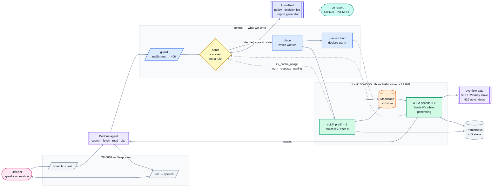
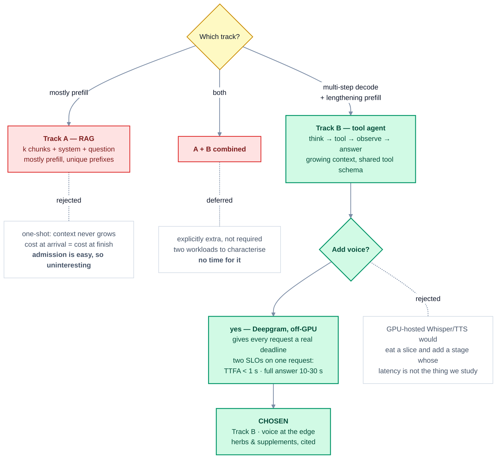
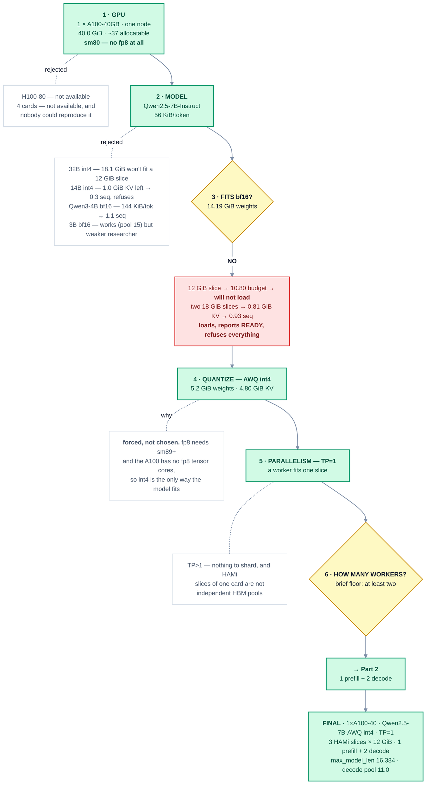
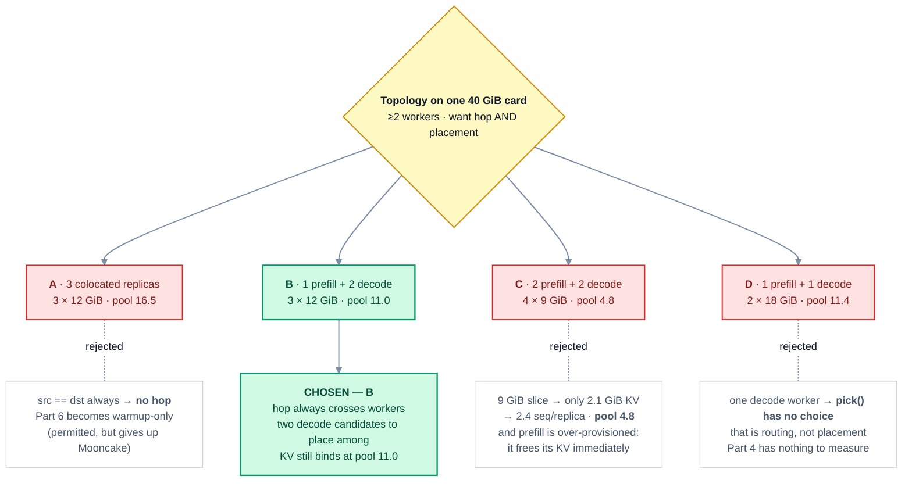
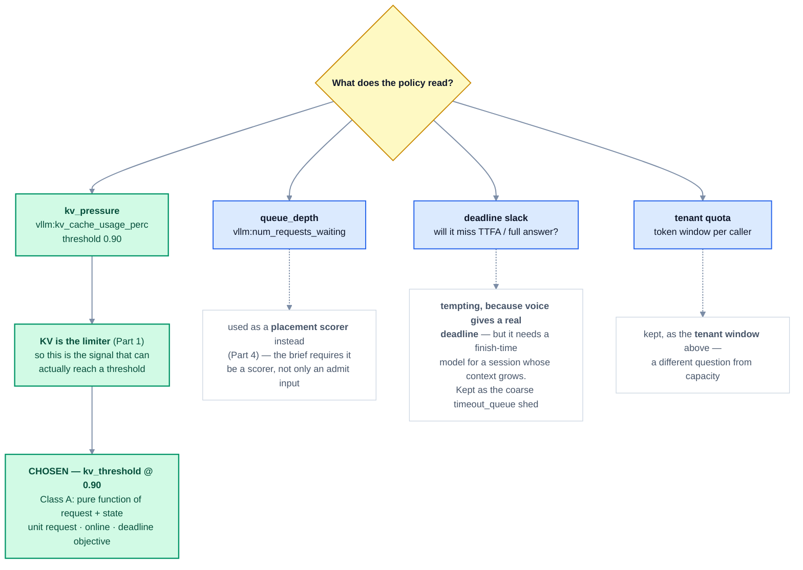
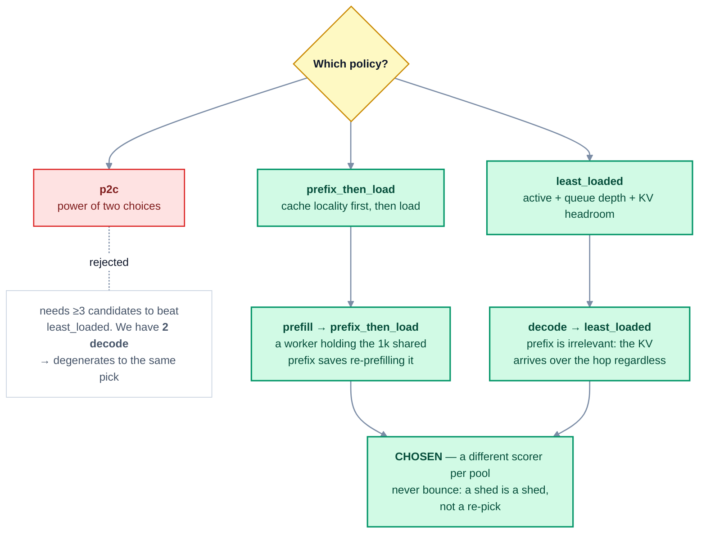
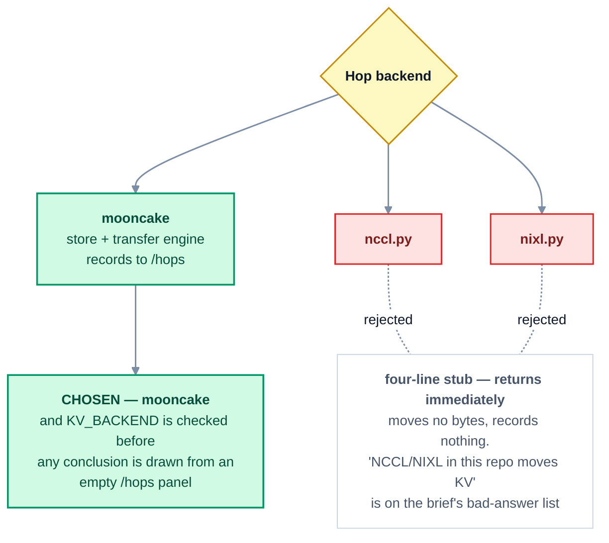

# Submission — design the cluster and serve an app

Answers to the [project instructions](https://www.notion.so/hj1393/Cohort-Week-10-Final-Project-Instructions-3e9e2e4aacb48061ab1ed3930fc2813a),
part by part. **This is the go-to file.** Every part answers the brief in place
and links out.

| Go deeper | |
|---|---|
| [`PROJECT.md`](PROJECT.md) | The project: the problem, the decisions, and the **C4 architecture levels** |
| [`docs/project/`](docs/README.md) | Per-part deep dives: the full arithmetic, the run protocol, the results report |
| [`docs/cluster/`](docs/cluster/README.md) | The serving stack, file by file — gateway, router, KV bus, observability |

**Numbers are marked predicted or measured.** Predictions are written down
before the run and checked afterwards. They do not get edited to match.
`TBM` means to-be-measured — a `TBM` left here is a hole we are disclosing.

---

## Summary

**The application.** Dodona is a **voice** research agent for herbs and
supplements, served from a cluster we configure ourselves. You speak a question;
it searches, fetches sources, reads them, and answers aloud with citations. It
works over several turns and calls tools in between. Deepgram does speech-to-text
and text-to-speech **off-GPU**; the GPU serves only the model.

This is hard on a GPU for two reasons that matter later.

**First, context grows.** Every turn resends the whole conversation. One fetched
source is ~12,000 tokens and arrives as a single large prefill — at the
configuration below that holds **0.66 GiB of KV, and a full 16k turn holds
0.88 GiB: 18% of everything a decode worker has.** The cluster is therefore
deciding, more or less constantly, which requests to let in.

**Second, voice puts a real deadline on every request.** One request carries two
different SLOs: **time-to-first-audio** must be under a second — an
acknowledgement, *"let me look that up"* — while **time-to-full-answer** is 10–30
seconds of research. A request that will miss its deadline is worth refusing at
the door rather than admitting and failing slowly.

**The problem.** That is admission control, and every LLM deployment does it
whether or not anyone designed it — usually by accident, when a queue fills up
and everything slows down. The question worth asking is which signal a policy
should watch: KV pressure, queue depth, deadline slack, or a tenant's quota.

**What we do.** Make admission a **plug-in socket** rather than a hardcoded
check, filled by [AdmitPerf](https://github.com/harshuljain13/AdmitPerf): the
policy declares what signal it reads, every decision writes a row carrying the
value it read, and a one-page report at the end of each run says whether that
signal ever reached its threshold. If it never did, the policy was installed and
inert — and that is worth knowing too.

The deliverable is the cluster, the agent in front of it, the control plane, and
one worked report for one policy (`kv_threshold` at 0.90) on real agent traffic.

We are not comparing four policies and declaring a winner. One cluster cannot
support that claim.

### The three pieces

| Piece | Role | What we do to it |
|---|---|---|
| [AgentShip](https://github.com/Agent-Ship/agent-ship) | The app — a research agent, plus `agentship-voice` for the speech loop | Point its `api_base` at our gateway |
| [AdmitPerf](https://github.com/harshuljain13/AdmitPerf) | The policy registry, the per-decision log, the report generator | Install it in the request path as the admission socket |
| The cluster | Three vLLM workers, the KV hop, the dashboards | Built stage by stage, in the shape of the class-10 lab |

### High level

Three boxes: the app, the control plane we write, the engine we configure.
Detailed C4 levels are in [`PROJECT.md`](PROJECT.md#architecture).



Deepgram sits outside the GPU box on purpose: speech is a **network constant**,
so the contention we measure is purely LLM-side.

### The four resources and the six decisions

| Constrained by | Where it shows up |
|---|---|
| **decode slots** | `max_num_seqs` 64 per pod — never the binding limit here |
| **KV blocks** | 4.80 GiB per decode worker → **the limiter.** [Part 1](#part-1--capacity-on-paper) |
| **hop bandwidth** | prefill → Mooncake → decode, inside one card. [Part 6](#part-6--hop-when-do-you-move-kv-is-the-replica-warm) |
| **warmup time** | `READY` precedes serving by minutes. [Part 6](#part-6--hop-when-do-you-move-kv-is-the-replica-warm) |

| Decision | Part |
|---|---|
| guard · admit · stay vs leave | [3](#part-3--guardrails-admit-stay-vs-leave) |
| place | [4](#part-4--place) |
| queue (hop) · declare warm | [5](#part-5--queue), [6](#part-6--hop-when-do-you-move-kv-is-the-replica-warm) |

---

## The configuration, in one block

**1 × A100-40GB on one Lambda node. `Qwen2.5-7B-Instruct-AWQ` at int4. TP=1,
three workers on three HAMi slices: one prefill and two decode.
`max_model_len` 16,384, `max_num_seqs` 64. Mooncake for the hop. Overflow is the
a smaller model on Superlinked, hard-capped.**

```
one A100-40GB  ·  40.0 GiB reported  ·  ~37 GiB allocatable across 3 pods

slice  pod         gpumem   gpucores   weights   KV        seq @16k
  0    prefill-0   12 GiB     40%      5.2 GiB  4.80 GiB    5.5
  1    decode-0    12 GiB     28%      5.2 GiB  4.80 GiB    5.5   <- placement
  2    decode-1    12 GiB     28%      5.2 GiB  4.80 GiB    5.5   <- placement
                   -------    ----
                   36 GiB      96%        decode pool = 11.0 concurrent
```

One A100-40 is also what a cohort mate or a workshop attendee can actually rent,
so the result is reproducible.

---

## Part 0 — The application: what are you serving?

**Track B — tool-using agent**, with voice at the edge. A user turn starts a
loop: think → tool → observe → answer. Context grows every step. The system
prompt plus tool schemas are a shared prefix; the conversation is not.

**Domain: herbs and supplements — interactions and evidence.** Specific on
purpose. Spoken queries fit the situation (hands busy in a kitchen or a clinic),
citations are the entire point, and the deliverable is *sourced information*, not
a recommendation. The domain is a config — swapping it for patents or case law
changes the prompt and the tool list and nothing else. **The serving problem is
the project.**

### Why Track B, and why voice



Track A's requests are one-shot: what a request costs at arrival is what it costs
at the end. Track B's are not — **a policy that judges cost at arrival will admit
sessions it cannot finish.** That is the whole reason it is the harder shape.

### Shared vs unique tokens

The brief asks this directly in Part 8. Answering here because it determines
everything about prefix caching and placement.

| Per request | Tokens | Shared or unique |
|---|---|---|
| System prompt + 4 tool schemas | ~1,000 | **Shared** — byte-identical every turn, every session, every user |
| The spoken question, transcribed | ~40 | Unique per session |
| Fetched source text | ~12,000 | Unique, arrives in one turn |
| Conversation so far | grows each turn | Unique per session |

All **predicted**; measured at [Part 8](#part-8--proof-measure-the-app-not-a-generic-trace).

Tools are AgentShip builtins — `web_search`, `scrape_url`, `http_request`,
`calculator`. Nothing new is written on the app side.

→ [`docs/project/00-use-case.md`](docs/project/00-use-case.md)

## Part 1 — Capacity on paper

The brief's formula, on the GPU we actually ran:

```
max_concurrent_seqs ≈ (HBM − weights − activations) / (kv_bytes_per_token × max_len)
```

### `kv_bytes_per_token`

`Qwen2.5-7B-Instruct`: 28 layers, 28 Q heads, **4 KV heads**, head_dim 128.

```
kv_bytes_per_token = 2 (K,V) x 28 layers x 4 kv_heads x 128 head_dim x 2 B
                   = 57,344 B  =  56 KiB per token
```

**We did switch models, and here is what it did to bytes/token** — the brief asks
for exactly this:

| Considered | layers × kv_heads | KV/token | vs chosen |
|---|---|---|---|
| **`Qwen2.5-7B`** (chosen) | 28 × 4 | **56 KiB** | — |
| `Qwen2.5-3B` | 36 × 2 | 36 KiB | 0.6× — cheaper, but a weaker researcher |
| `Qwen3-4B` | 36 × 8 | 144 KiB | **2.6× more**, for 1.9× *fewer* params |
| `Qwen2.5-14B` | 48 × 8 | 192 KiB | 3.4× more |
| `Qwen2.5-32B` | 64 × 8 | 256 KiB | 4.6× more |

**Parameter count does not predict cache cost.** Qwen3-4B is 47% smaller than
our 7B and costs 2.6× more per token, because it has twice the KV heads and 8
more layers. Quantization changes the *weights*; only architecture changes
bytes/token.

### The budget, per slice

`gpu_memory_utilization = 0.90` applies to the **slice**, not the card — HAMi
gives the pod a hard `gpumem` cap that it sees as its entire device. Reading the
0.90 against the card inflates KV by 3×.

```
any worker:  12 GiB x 0.90  =  10.80 GiB budget
             - weights       =   5.20 GiB   <- 48% of the slice is weights
             - activations    =   0.80 GiB
                                ----------
             KV              =   4.80 GiB

one 16k sequence = 56 KiB x 16,384 = 0.875 GiB
concurrency      = 4.80 / 0.875   = 5.5 seq/replica
decode pool (x2)                  = 11.0 concurrent
```

### At `max_len` and at the length the app actually sends

The brief asks for both. They differ by 16×, which is the point.

| Length | Why this length | GiB/seq | % of a cache | seq/replica | **decode pool** |
|---|---|---|---|---|---|
| 16,384 (`max_len`) | engine ceiling | 0.875 | 18% | 5.5 | **11.0** |
| ~15,400 (turn 4, worst real request) | 1k prefix + 12k source + ~2.4k history | 0.822 | 17% | 5.8 | 11.7 |
| ~8,100 (mean across a session) | turns 1–4 averaged | 0.433 | 9% | 11.1 | 22.2 |
| ~1,040 (turn 1) | prefix + question only | 0.056 | 1% | 86.4 | 172.8 |

The fleet serves **11 concurrent sessions in the worst case and ~22 at the
average request size.** Admission matters in the first regime and not the second
— which is why load level is the x-axis of the experiment in Part 8.

### The decision chain



Two boxes deserve reading twice.

**Step 3 is the trap.** 7B at bf16 is 14.19 GiB against a 10.80 GiB budget — it
will not load at all on a 12 GiB slice. Widen to two 18 GiB slices and it *does*
load, leaving 0.81 GiB for KV where one 16k sequence needs 0.875 — so the pod
reports `READY 1/1` and then refuses every request that arrives. A config check
that only compares weights against available memory lets this straight through;
it has to require room for **at least one sequence at `max_model_len`**.

**Step 4 is forced, not chosen**, and it is worth being precise about why. On an
sm80 card there are no fp8 tensor cores, so the usual "quantize the weights to
fp8, keep KV in fp16" move does not exist. int4 via AWQ is the only thing that
makes a 7B fit three ways on a 40 GiB card. On a larger card we would have
*declined* to quantize — freeing memory would have tripled concurrency and left
nothing for admission to bind on. Here it is the price of entry.

### Which limiter do we expect first?

**KV.** Written down before the run.

| Candidate | Why not |
|---|---|
| weights | 5.20 GiB fits the 10.80 GiB budget comfortably |
| **KV** | **4.80 GiB / 0.875 GiB = 5.5 sequences. This binds** |
| compute | 5 concurrent sequences is a small batch |
| interconnect | TP=1, so no all-reduce. The hop stays inside one card |
| scheduler | `max_num_seqs` 64 is ~12× what KV allows |

Why KV binds is worth stating plainly: **48% of each slice is model weights.**
Replicating three times costs 15.6 GiB of the 36 GiB allocated, leaving 14.4 GiB
of KV across the fleet where a single whole-card worker would have had 26.6 GiB.
**Replication costs 12.2 GiB of KV** — that is the price of having three
addressable workers, and it is the central trade of the design.

Checked at [Part 8](#part-8--proof-measure-the-app-not-a-generic-trace): if
`gpu_cache_usage_perc` saturates before `num_requests_waiting` grows, the
hypothesis held.

→ [`docs/project/01-capacity.md`](docs/project/01-capacity.md)

## Part 2 — Design the cluster

| # | Item | Choice | Why |
|---|---|---|---|
| 1 | **GPU** | 1 × A100-40GB, one node | What is obtainable. sm80, so no fp8 — which forces int4 and shapes everything downstream |
| 2 | **model** | `Qwen2.5-7B-Instruct-AWQ` int4 | 56 KiB/token against a 16k app length. See the chain above |
| 3 | **topology** | prefill/decode split, 1 + 2, on **HAMi** slices | Sliced because one card must yield three addressable workers. Split so the hop is never a no-op |
| 4 | **concurrency** | `max_num_seqs` 64, `max_model_len` 16,384 | 64 sits far above what KV allows, so the cache runs out before the scheduler does — if it were lower, a KV policy could never fire |
| 5 | **hop backend** | Mooncake | The only one of the three that moves bytes. `nccl.py` and `nixl.py` return immediately |
| 6 | **overflow** | **`Qwen/Qwen3.5-4B` on Superlinked** (`OVERFLOW_BACKEND=superlinked`) | On 503/529 only, never 429. Two limiters, both named: `OVERFLOW_MAX_TOKENS=64` caps the answer, `OVERFLOW_MAX_REQS=20` caps the **lifetime** of the gateway process — not a rate. **A 4B answering for a 7B is a relief valve, not equivalent service**, so overflowed responses are never pooled with local ones when reporting anything about quality |

### Gateway and engine are two different boxes

| | Owns |
|---|---|
| **`control/`** (ours) | guard, admit, place, our queue, hop, declare warm, stay-vs-leave |
| **Engine** (vLLM) | waiting queue, block table, preemption, kernels, `fcfs`, chunked prefill |

We set engine flags. We do not reimplement its scheduler.

### Topology



**One prefill worker is enough** because prefill builds KV and frees it
immediately — it never holds a live sequence, so it is not what gates
concurrency. Two decode workers is the minimum for `pick` to be a real decision.

### What slicing costs, and what `gpucores` actually is

The concept most easily got wrong: **HAMi's `gpucores` caps a pod's share of SM
*time*; it does not give it dedicated SMs.** So the usual argument for
disaggregation — that a long prefill cannot stall another worker's decode loop —
only partly holds, because all three pods contend for the same SMs through a
scheduler quota. On three separate cards the isolation would be physical.

**Any inter-token latency spike on decode during a large prefill is this
effect**, and it would not appear on a multi-card fleet. We expect to see it and
we will say so — it is prediction P7.

### If we scale, which pool?

- **uncached prefill tokens rising** → prefill is the constraint → add prefill
- **decode slots hot / `num_requests_waiting` growing on decode** → add decode

"Add a replica" is not an answer. On this card a replica costs 5.2 GiB of
duplicated weights straight out of fleet KV, so it multiplies KV pressure rather
than relieving it.

### The integrity check, before any run is believed

```
kubectl get pods -o wide                                   # 3 vllm pods, Running
nvidia-smi --query-compute-apps=pid,used_memory --format=csv
#  -> 3 processes on index 0, each ~10-11 GiB, none above its slice
```

The failure mode is the inverse of a multi-card fleet's. There, the danger is two
pods landing on one card. Here it is **one pod exceeding its slice and quietly
taking memory from another** — so the check is that HAMi is enforcing the cap.

Pods start **one at a time**; three contending at startup can leave one with half
the KV of its peers, and a fleet with unequal caches makes the pool-wide
concurrency figure wrong.

→ [`docs/project/02-cluster.md`](docs/project/02-cluster.md) ·
[`docs/cluster/infrastructure.md`](docs/cluster/infrastructure.md)

## Part 3 — Guardrails, admit, stay vs leave

```
inspect(payload) → Guard
should_shed(req, snap) → (shed?, code, reason, retry_after_seconds)
```

Three gates, cheapest first. A refusal never costs a GPU.

| Gate | Question | Code | Leaves? |
|---|---|---|---|
| `inspect` | well-formed? model in allowlist? token limit sane? | 400 | no |
| tenant window | is this caller over their share? | 429 | **never** |
| `should_shed` | can the fleet serve this now, in time? | 503 | yes, up to the cap |
| — | upstream overloaded | 529 | yes, same cap |

The tenant window runs **before** the capacity question, deliberately: a 429 is
client-attributable, and **a 429 that overflowed is on the brief's bad-answer
list** — paying a provider for a request we are refusing on policy grounds is
overspending, not a capacity event.

### Which signal should admission watch?



Admission is a **socket, not a rule** — `ADMISSION_POLICY` selects from
AdmitPerf's registry with no code change. **The baseline is `no_admission`, not
the gate switched off**: with the gate off nothing is logged, so the comparison
would have one side.

Three details that each prevent a report that looks fine and is wrong:

- **A missing metric is omitted, never zeroed.** `kv_cache_usage: 0.0` reads as a
  completely empty cache — the one value that guarantees every policy admits. A
  failed scrape would silently switch admission off.
- **Pressure comes from the replica with the most headroom**, not the average,
  because that is where the router will place. An average lets one idle replica
  hide a saturated fleet.
- **The policy fails open**, with `admitperf_gate_active` as a separate metric, so
  a crashing policy is distinguishable from `no_admission`.

→ [`docs/project/03-admission.md`](docs/project/03-admission.md) ·
[`docs/cluster/gateway.md`](docs/cluster/gateway.md)

## Part 4 — Place

```
pick(req, workers, *, policy) → Worker | Shed
```

Two decode candidates, so this is a real decision. **Prefill and decode use
different scorers**, and **queue depth is a scorer here, not only an admit
input**, as the brief requires.



| Pool | Scorers, in order |
|---|---|
| prefill | prefix-cache locality → uncached prefill tokens → KV headroom |
| decode | active requests → **queue depth** → KV headroom |

**Do not bounce.** If `pick` returns `Shed`, the request is refused with a reason
— it is not re-offered to another worker, which would turn one refusal into three
attempts' worth of latency and make the shed-by-reason panel meaningless.

**One limitation, named rather than implied.** The decode destination is chosen
*before* prefill runs. A 12k prefill takes on the order of a second, and by then
the decode worker picked may no longer be the least loaded. Deciding at transfer
time would place better. Named so that any decode imbalance in the run is
attributed here and not to the admission policy.

→ [`docs/project/04-placement.md`](docs/project/04-placement.md) ·
[`docs/cluster/router.md`](docs/cluster/router.md)

## Part 5 — Queue

```
admit → place → our queue → engine waiting / running / preempt
```

**The notebook is the deliverable for this part** —
[`notebook/part5-queue.ipynb`](notebook/) — because every answer below needs a
live scrape, not an assertion. *Status: not written.*

| Question | Answer | Source |
|---|---|---|
| Who sits in **our** queue vs vLLM's **waiting** queue? | Our control plane holds **no queue** — requests block on a thread. The real queue is inside the engine. That is why `queue_depth` is scraped from `/metrics` rather than read from a local structure, and why `defer` means "come back", not "you are 12th" | scrape |
| waiting / running / swapped? | *TBM* | `vllm:num_requests_{waiting,running,swapped}` |
| `orch_replica_queue_depth` — which pod, under which mix? | *TBM* | per-pod scrape |
| A 16k research retrieve and a short agent step are both ready — who goes first, us or the engine? | **Us, then the engine.** We admit and place; the engine orders within its own batch by `fcfs` + chunked prefill. We do not reorder inside it | notebook |
| PagedAttention **packs**, prefix cache **reuses** — which saved memory on our mix? | **Prefix cache**, predicted: ~1k of system prompt + tool schemas is identical across every turn and session. Paging prevents fragmentation but does not dedupe | `prefix_cache_hit_rate` |
| Chunked prefill / continuous batching flags, and why? | `--enable-prefix-caching` for the shared prefix; `--max-num-seqs 64` deliberately above the KV limit so the cache binds first; `--max-num-batched-tokens` *TBM* — a 12k prefill must not starve decode, which matters more here because voice makes the stall audible | config + scrape |
| KV full after admit — shed at the door, or engine preempts? | **Shed at the door.** `kv_threshold` 0.90 leaves headroom precisely so the engine does not have to preempt a sequence it already started. A non-zero preemption count means the gate let through more than the fleet could hold | `vllm:num_preemptions` |
| Client gone (`aborted`) — who frees the KV, and how? | The engine. We mark `Request.aborted` and stop reading; vLLM drops the sequence and returns its blocks. **Voice makes this common** — a listener who talks over the answer aborts mid-generation | notebook |
| After a worker returns — slam it at 100%, or ramp? | **Ramp.** `READY` precedes serving by minutes while CUDA graphs capture. Slamming a just-returned worker quotes a TTFT that is warmup, not inference | [Part 6](#part-6--hop-when-do-you-move-kv-is-the-replica-warm) |

→ [`docs/project/05-queue.md`](docs/project/05-queue.md)

## Part 6 — Hop: when do you move KV? Is the replica warm?

With topology B, **`src != dst` always** — prefill is pod 0, decode is pod 1 or 2
— so the hop is never a no-op and there is always a transfer to record.

| Case | What we do |
|---|---|
| `src == dst` | Cannot happen in this topology. Would be: do nothing |
| `src != dst` | Record a hop: from `prefill-0`, to `decode-{0,1}`, this many tokens, this prefix, backend `mooncake` |

### Is the move worth it?

```
a 12k prompt produces 12,288 x 56 KiB = 0.656 GiB of KV

recompute on the decode worker   ~2.5-3.7 s   (predicted — 2·N·T FLOPs at 28% of an A100-40)
move via Mooncake, same card     ~0.5-0.8 s   (prior, not prediction — see below)
```

The ~0.5–0.8 s figure is **borrowed from a published single-GPU run**, not
derived: a comparable stack measured LMCache hop-plus-store-barrier at 0.5–0.8 s
and NIXL pod-to-pod over TCP at ~4 s. Our own first-principles estimate for a
device→host→device copy of 0.656 GiB was ~150 ms, which that measurement says is
optimistic by 3–5×. **We quote the measured prior and will replace it with our
own number.** If the transport lands near 4 s, the hop is slower than recomputing
and the conclusion flips.

The honest comparison is not against recompute, though — it is against **not
splitting at all**: a colocated replica (topology A) keeps the KV in place and
moves nothing. Disaggregation's cost on one card is this transfer; what it buys
is phase separation, and `gpucores` time-slicing only partly delivers that.

### Which backend



### Is it actually warm?

Two different things get called warmth and only one is about the hop.

| | What it is | The measurement hazard |
|---|---|---|
| **Worker warmth** | `torch.compile` has captured its CUDA-graph buckets | `READY 1/1` appears **minutes** before the engine can serve. A TTFT off a cold replica is the brief's "quoting TTFT from a cold replica as the SLO" |
| **Cache warmth** | the shared prefix is resident in the worker's prefix cache or in Mooncake | After a hop onto a fresh decode replica, was the first token slow because warmup was still finishing? |

**The protocol:** warm every pod with a fixed request, then **re-quote the TTFT**.
The first-agent-step TTFT after a hop onto a newly-started decode replica is
measured both cold and warm, and only the warm number is quoted as an SLO.

Warmth matters more here than in a text app: **a cold replica's first token is
audible as dead air.** The ~1.8 s first-request penalty of single-bucket CUDA
graph capture is invisible in a chat box and glaring in a voice turn.

→ [`docs/project/06-hop.md`](docs/project/06-hop.md) ·
[`docs/cluster/kvbus.md`](docs/cluster/kvbus.md)

## Part 7 — Wire the app to the cluster

Every completion goes through our serve path. **Completions that skip
guardrails / admit / place / queue do not count**, so there is no direct route
from the agent to a worker.

```
spoken turn → Deepgram STT → agent step
        ↓
guardrails.inspect
        ↓
admit  (tenant window, then kv_threshold)
        ↓
place  (pick — prefix_then_load | least_loaded)
        ↓
queue  →  transfer(prefill-0, decode-{0,1})
        ↓
engine  /v1/chat/completions
        ↓
overflow gate   429/500/slice_oom stay · 503/529 may leave
        ↓
Deepgram TTS → spoken answer
```

```yaml
# app/dodona.yaml
model: openai/Qwen2.5-7B-Instruct-AWQ
params:
  api_base: "http://127.0.0.1:8080/v1"
```

**Open WebUI first.** Stage 1 points Open WebUI straight at the engine for hand
testing, before any control plane exists. That way a broken agent and a broken
gateway are never confused for each other.

Three settings that are choices, not defaults:

| Setting | Value | Why |
|---|---|---|
| `temperature` / `top_p` | 0.3 / 0.8 | Qwen2.5's recommended sampling. Greedy decoding degenerates and emits tool calls as prose |
| `scrape_url` truncation | 12k tokens | So a turn-4 request fits in 16,384. An engine context refusal looks nothing like an admission refusal in the decision log |
| tool calls per reply | one | The `hermes` parser returns the *entire batch* as text when any single call is malformed |

Engine side needs `--enable-auto-tool-choice --tool-call-parser hermes`.

**Smoke the engine before debugging the serve path**, in this order:

| # | Check | Passes when |
|---|---|---|
| 1 | `curl` a worker directly | 200, text back — the engine is alive |
| 2 | Open WebUI → engine | you can talk to it in a browser |
| 3 | `curl` the gateway, plain completion | 200 — the serve path works |
| 4 | `curl` the gateway **with `tools`** | response has `tool_calls`, not prose |
| 5 | agent, one spoken question | `web_search` fires |
| 6 | agent, full question | multi-turn, cites a URL it actually fetched |
| 7 | decision log non-empty, `admitperf_gate_recording 1` | one row per completion |

**TTFT comes from vLLM's metrics, never from the client** — and with voice there
are two client-side numbers (first audio, full answer) that are both *downstream*
of engine TTFT, so conflating them would be doubly wrong.

→ [`docs/project/07-wiring.md`](docs/project/07-wiring.md) · [`app/README.md`](app/)

## Part 8 — Proof: measure the app, not a generic trace

Traffic is produced by the agent itself. The load generator exists only to replay
the **same** trace across runs so two runs are comparable.

| Run | Policy | Concurrent sessions | Why |
|---|---|---|---|
| `low-baseline` | `no_admission` | 2 | the other side of the comparison |
| `low` | `kv_threshold` 0.90 | 2 | ~18% of the 11.0 pool; pressure should stay under 0.90 |
| `high-baseline` | `no_admission` | 14 | the other side |
| `high` | `kv_threshold` 0.90 | 14 | past the pool; pressure should reach 0.90 |

Three seeds each. All results *TBM*.

### The eight dashboards

| # | Dashboard | Points at |
|---|---|---|
| 1 | Cluster | *TBM* |
| 2 | Success and failures | *TBM* |
| 3 | Gateway + admission — sheds by reason | `tenant_tokens`, `timeout_queue`, `kv_free` |
| 4 | Router | placement by pod, prefix-match rate |
| 5 | Queue depth by pod | `orch_replica_queue_depth` |
| 6 | vLLM | KV usage, waiting/running, preemptions, prefix hits |
| 7 | Mooncake KV | `/hops`, bytes moved, failed writes, evictions |
| 8 | Pods / replicas | 3 pods on 1 GPU, slice enforcement |

### The brief's questions

| Question | Answer |
|---|---|
| What is the app, which tokens shared vs unique? | [Part 0](#shared-vs-unique-tokens) — ~1k shared prefix, ~12k unique source |
| What dies at guardrails vs admit vs place vs queue? | *TBM* — the shed-by-reason panel is the answer |
| Where do I prevent work that will time out? | `timeout_queue` shed at admit. **Voice makes this concrete**: a request that cannot make its TTFA budget is better refused aloud than admitted and left silent |
| Where do I protect KV? | `kv_threshold` 0.90 at admit, plus KV headroom as a placement scorer |
| Where do I prioritise interactive traffic? | *TBM* (`p99_spread`) |
| Where do I stop one tenant owning the GPU? | the tenant window, before capacity — a 429 that never leaves |
| Where do I hop, and what is **not** copied? | prefill-0 → decode-{0,1} over Mooncake. **Not copied:** the final token's KV (recomputed), anything past the 256-token chunk boundary, and any block already in the destination's prefix cache |
| Where do I evict, and what becomes a ghost if I skip it? | `control/kv_eviction.py`. Skip it and a hopped prefix stays pinned in Mooncake after its session ended — a ghost holding store capacity nothing will read |
| Where does the engine scheduler sit vs our admit/place/queue? | [Part 2](#gateway-and-engine-are-two-different-boxes) |
| What limited concurrency on this GPU for this app? | **KV** — predicted. 4.80 GiB per decode worker ÷ 0.875 GiB = 5.5 sequences |
| Four production alerts? | (1) `admitperf_gate_recording == 0` — deciding but not logging; (2) `vllm:num_preemptions > 0` — the gate admitted more than the fleet holds; (3) hop count flat while prefill tokens rise — the transport silently stopped; (4) p99 time-to-first-audio > 1.5 s — the only SLO the listener can hear |
| If I scale, which pool? | [Part 2](#if-we-scale-which-pool) — prefill tokens → prefill, decode slots → decode |
| At 10× traffic, and three wrong knobs? | **Right:** a bigger card so int4 is no longer forced, then a second prefill pod, then shard sessions by tenant. **Wrong:** raising `max_num_seqs` (the scheduler is not the limit), adding an identical replica (costs 5.2 GiB of weights out of fleet KV), raising the admission threshold (defers the wall, does not move it) |

### Predictions, written before the run

| # | Prediction | Measured | Held? |
|---|---|---|---|
| P1 | KV binds, not the scheduler | *TBM* | *TBM* |
| P2 | Signal reaches 0.90 at 14 sessions | *TBM* | *TBM* |
| P3 | Signal does not reach 0.90 at 2 sessions | *TBM* | *TBM* |
| P4 | Prefix-cache hit rate > 70% | *TBM* | *TBM* |
| P5 | Prompt:completion ratio > 10:1 | *TBM* | *TBM* |
| P6 | `kv_bytes_per_token` = 56 KiB ±5% | *TBM* | *TBM* |
| P7 | Inter-token p95 on decode spikes during a large prefill (`gpucores` is time-sliced) | *TBM* | *TBM* |
| P8 | Mooncake hop ≫ our 150 ms estimate, closer to the 0.5–0.8 s published prior | *TBM* | *TBM* |

P6 comes first in time — read off `config.json` on a live worker. Every
concurrency figure in Part 1 moves with it.

→ [`docs/project/08-proof.md`](docs/project/08-proof.md) ·
[`docs/project/results-report.md`](docs/project/results-report.md)

---

## Bad answers we are explicitly avoiding

| Bad answer | Where we avoid it |
|---|---|
| "`bench latency` batch=8 is the production SLO" | SLOs come from agent traffic, [Part 8](#part-8--proof-measure-the-app-not-a-generic-trace) |
| "Cache is full, add another replica" | [Part 2](#if-we-scale-which-pool) — a replica costs 5.2 GiB of fleet KV |
| "NCCL/NIXL moves KV tensors" | [Part 6](#which-backend) — both are stubs |
| "A replica is ready when weights are on the GPU" | [Part 6](#is-it-actually-warm) — warm, then re-quote |
| "Overflow is Superlinked / another API" with no model and no limiter named | [Part 2](#part-2--design-the-cluster) item 6 — the brief names this one directly. Ours: `Qwen/Qwen3.5-4B`, capped by `OVERFLOW_MAX_TOKENS=64` and `OVERFLOW_MAX_REQS=20` lifetime |
| "I reimplemented vLLM's scheduler" | [Part 2](#gateway-and-engine-are-two-different-boxes) |
| A 429 that overflowed | [Part 3](#part-3--guardrails-admit-stay-vs-leave) — ordering is load-bearing |
| "RAG is a third phase" | Two phases: prefill, decode |
| Wall seconds across models without token counts | Every comparison carries tokens |
| TTFT from a cold replica | [Part 6](#is-it-actually-warm) |

## What is built and what is not

Dodona is built **stage by stage** — nothing is inherited wholesale. Runbook:
[`RUNBOOK.md`](RUNBOOK.md).

| | |
|---|---|
| The design, the arithmetic, the decision trees | **This document** |
| Stages 0–10 | **None started.** See [`README.md`](README.md#status) |
| Any measured number | **None.** All `TBM` |

Reference implementations we port from, piece by piece, rather than run as a
black box: the class-10 lab (gateway, router, Mooncake, HAMi, dashboards) and
AdmitPerf (policy registry, decision log, report).
