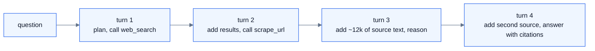

# Part 0 — The application and the workload

## The application

A deep research agent on [AgentShip](https://github.com/Agent-Ship/agent-ship).
You give it a question; it plans, searches, fetches sources, reads them, and
answers with citations. It works over several turns and calls tools in between.

`Qwen2.5-32B-Instruct-AWQ` is a text model, so the agent is text in, text out.
AgentShip's `scrape_url` builtin pulls text out of HTML; figures and page layout
never reach the model. The engine only ever sees an ordinary chat completion.

Four builtins carry the whole app, and all four already exist in
`agentship-core`:

| Tool | File | Role |
|---|---|---|
| `web_search` | `tools/builtins/web_search.py` | Find candidate sources |
| `scrape_url` | `tools/builtins/scrape_url.py` | Fetch one and extract its text |
| `http_request` | `tools/builtins/http_request.py` | Direct fetch when a URL is already known |
| `calculator` | `tools/builtins/calculator.py` | Arithmetic the model should not do in its head |

Nothing new gets written on the app side. The agent is a YAML spec plus a
prompt; the work is in the wiring ([Part 7](07-wiring.md)).

## A session, turn by turn



Each turn resends the whole conversation, so context grows through the session
and the same opening prefix is sent over and over.

| Per request | Tokens | |
|---|---|---|
| System prompt + tool schemas | ~1k | **Shared.** Byte-identical on every turn, for every user |
| The question | ~50 | Unique |
| Fetched source text | ~12k | Unique, arrives in one turn |
| Conversation so far | grows each turn | Unique |

All four figures are **predicted**. They get measured at
[Part 8](08-proof.md) from a real session, and the prediction stands as written.

### Why 12k and not 15k

A design decision, not an estimate. `scrape_url` output is truncated to 12k
tokens so that the worst-case request fits inside `max_model_len`:

```
1k prefix + 12k source + ~2k conversation so far  =  ~15k  <  16,384
```

Without the cap, a long article plus three turns of history overruns 16,384 and
vLLM refuses the request. A refusal from the engine's context limit looks
nothing like a refusal from admission control, and mixing the two in one run
would make the decision log unreadable. So the cap exists to keep the only
refusals in the log the ones the policy caused.

## Why this workload is the right one to measure admission on

Four properties put pressure on different parts of the control plane.

- **One turn is a very large prefill.** 12k tokens is 3.0 GiB of KV — about a
  fifth of a worker's cache for a single request. Admission here is not deciding
  about a chat message; it is deciding whether to hand a meaningful slice of a
  GPU to one caller.

- **There is a big shared prefix.** The system prompt and tool schemas are
  identical across every user and every turn, so prefix caching has real work to
  do and placement that ignores cache locality will pay for it.

- **Context grows inside a session.** A request that was cheap on turn 1 is
  expensive by turn 4. A policy that judges cost at arrival will admit sessions
  it cannot finish.

- **Tool calls leave gaps.** The agent goes quiet while a search or fetch runs,
  then comes back. Load is bursty because of how the app works, not because a
  load generator was told to make it so.

The last property is the one a synthetic trace cannot reproduce honestly, and it
is why the proof in [Part 8](08-proof.md) comes from agent traffic rather than
from `locust`. The load generator still exists, for the one thing it is good at:
replaying the *same* trace across runs so two runs can be compared.

## What the literature does not cover

A [review of 55 admission-control papers](https://github.com/harshuljain13/AdmissionControlPolicies-Survey)
found 16 that propose a policy. **None of the 16 tests a multi-turn agent whose
context grows.** So this is the least-covered regime rather than the
best-covered one, which is the reason to pick it over RAG over a toy corpus.

## What is deliberately not in the app

- **No vector store, no retrieval index.** The agent fetches live. A retrieval
  index would make the prefill sizes uniform, and the variance is the point.
- **No multimodal.** Image prefill is a genuinely interesting admission regime
  and the gateway already has a vision path (`cluster/app/guardrails.py` carries
  `TEXT_MODEL`/`VISION_MODEL` aliases), but vision token accounting is messy and
  there is no room for it in two days. Kept as the ODSC extension.
- **No quality evaluation of the answers.** Whether the agent researches *well*
  is a different project. We need its traffic shape, not its accuracy. Stated
  here because a reader will otherwise expect a correctness table.
