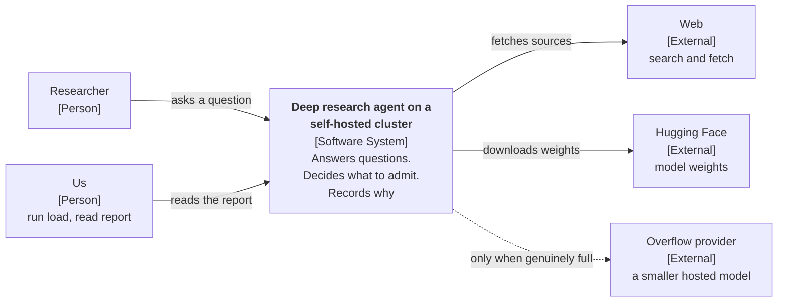
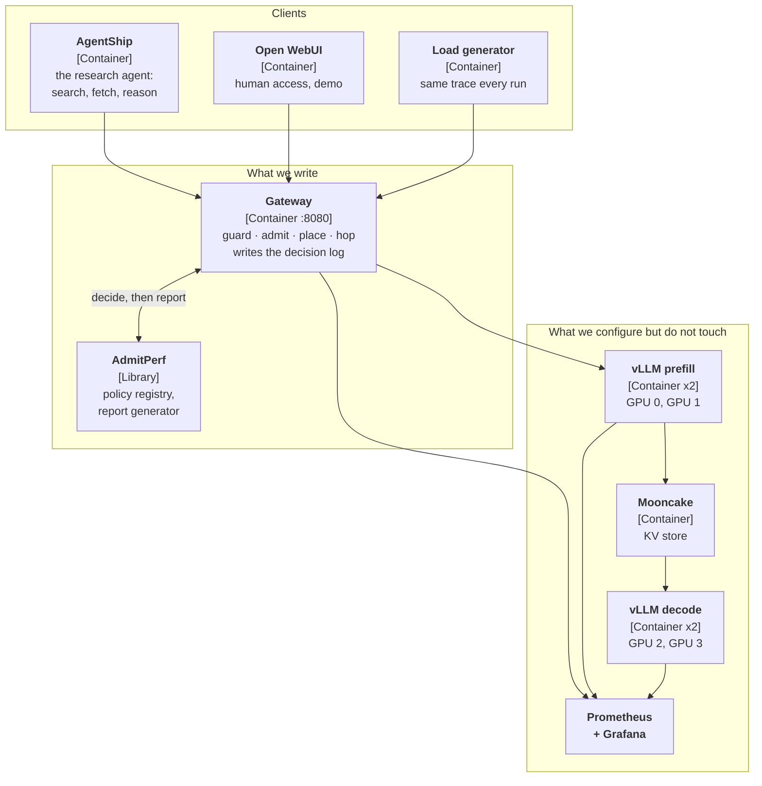
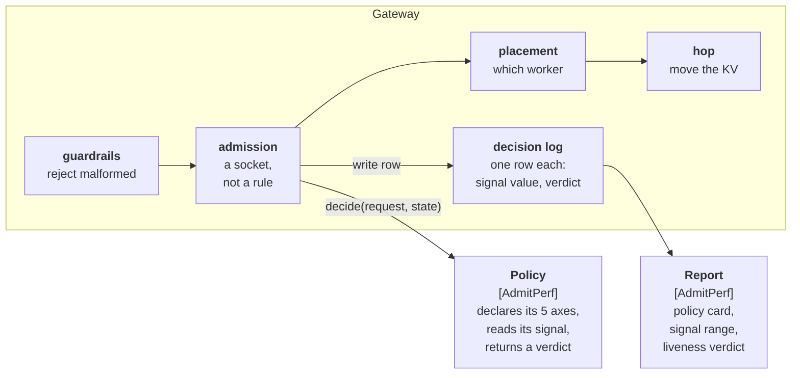
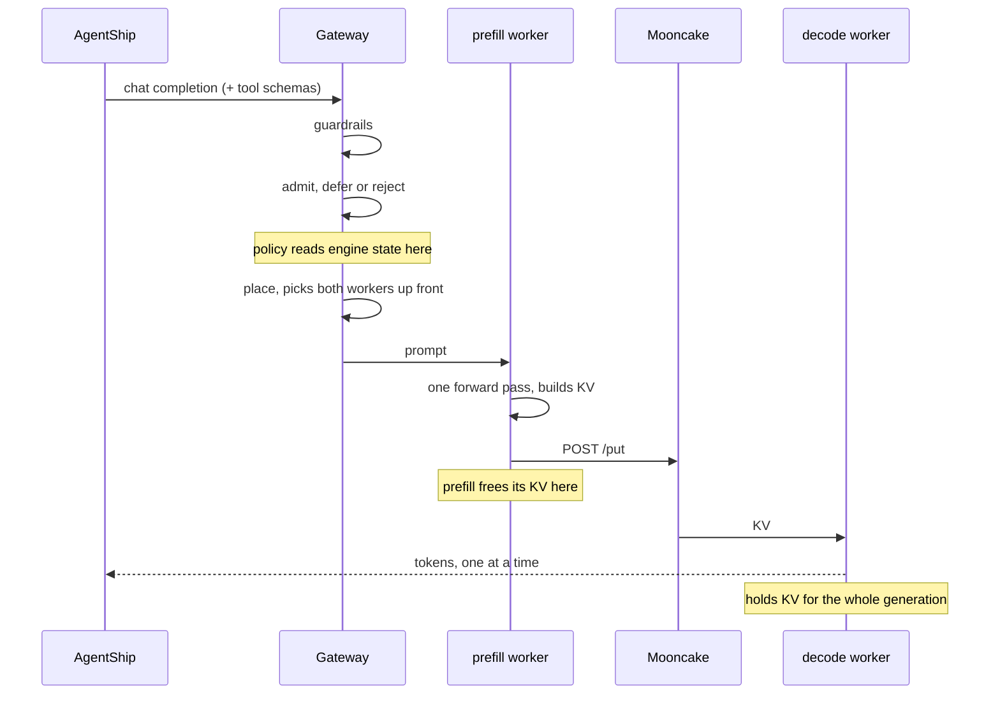

# Part 2 — The cluster

Described with the [C4 model](https://c4model.com): the system from outside,
then the containers it is made of, then inside the one container we write.

## Level 1 — Context



The dotted line is the only way out of the cluster and it is for capacity
failures alone. A tenant refusal stays local — a tenant over its own quota being
served on capacity we pay for is overspending, not a capacity problem.

## Level 2 — Containers



**AgentShip** proves the system works on real questions. The **load generator**
lets us compare runs fairly with the same trace each time. **AdmitPerf** supplies
the policies and produces the report. The gateway and the AdmitPerf integration
are the only things being written; everything in the third group is inherited
from module 10 and configured.

## Level 3 — Inside the gateway



Admission is a socket. It reads what the workers are doing, hands that plus the
request to a policy from AdmitPerf's registry, does what comes back, and writes
one row. The policy declares its five axes when it registers (unit, setting,
objective, signal, portability), which is how the report card fills itself in
without anyone remembering to do it.

**This exists.** `cluster/gateway/admitperf_gate.py` is the socket, configured
from the environment:

```
ADMISSION_POLICY      kv_threshold | queue_depth | dual_gate | no_admission
ADMISSION_THRESHOLD   0.90
ADMISSION_LOG         results/<run>/decisions.jsonl
ADMISSION_EXPERIMENT  a100-agent
ADMISSION_RUN         high-load
```

Leave `ADMISSION_POLICY` unset and the gate is off and the gateway keeps its own
behaviour. Two things in that file are worth knowing before reading any report:

- **A missing metric is omitted, never zeroed.** `kv_cache_usage: 0.0` reads as
  a completely empty cache, which is the one value that guarantees every policy
  admits — so a failed scrape would silently switch admission off.
- **Pressure comes from the replica with the most headroom**, not the average,
  because that is where the router will place. An average lets one idle replica
  hide a saturated fleet.

## What has to change for four physical GPUs

The vendored manifests are the single biggest piece of work in Part 2, and the
reason is in [Part 1 step 5](01-capacity.md#5--parallelism-tp1).

| | Vendored (module 10) | Module 11 |
|---|---|---|
| Physical GPUs | 1 | 4 |
| Pods | 1 prefill + 1 decode | 2 prefill + 2 decode |
| GPU request | `nvidia.com/gpu: "1"` **+ `gpumem: "16384"` + `gpucores: 55/35`** | `nvidia.com/gpu: "1"`, nothing else |
| Scheduler | HAMi, slicing one card | plain NVIDIA device plugin, one card per pod |
| Model | `Qwen2.5-3B-Instruct` | `Qwen2.5-32B-Instruct-AWQ` |
| `--quantization` | absent | `awq_marlin` |
| `max_model_len` | 2,048 | 16,384 |
| Files | `k8s-config/hami/hami-lambda.yaml`, `setup/lambda_apply_slices.sh` | replaced by `k8s-config/fleet/` |

`setup/lambda_apply_slices.sh` rewrites `gpumem` with `sed` to size slices
against whatever card `nvidia-smi` reports. It has no role here and is removed
rather than left to be run by accident.

### The check that has to pass before any run is believed

```
kubectl get pods -o wide                 # 4 vllm pods, 4 distinct nodes/devices
nvidia-smi --query-gpu=index,memory.used --format=csv
```

Four processes, one per GPU index, each at ~35 GiB. If three GPUs are busy and
one is idle, a pod is co-scheduled and the fleet is three workers pretending to
be four. Every number from that run is invalid, and nothing in the metrics would
say so.

## What happens to a request



The two pools score placement on different signals, because the phases care
about different things.

| Pool | Signals | Reason |
|---|---|---|
| prefill | prefix cache, token load, KV | A worker that already has the system prompt cached saves re-prefilling 1k tokens |
| decode | active requests, KV | Prefix does not matter here; the KV arrives over the hop regardless |

One limitation to name rather than leave implied: both workers are chosen before
prefill runs (`cluster/router/router.py`). A 12k prefill takes real time, and by
the time it finishes the decode worker we picked may no longer be the least
loaded one. Deciding the decode destination at transfer time would place better.
Covered in [Part 4](04-placement.md).

## The settings and why

| | Choice | Reason |
|---|---|---|
| GPU | 4 × A100-40, one node | Smallest fleet with both a hop and a placement decision; one node because the hop needs the interconnect |
| Model | `Qwen2.5-32B-Instruct-AWQ` | Scarcity comes from the hardware rather than from a cap we set |
| Quantization | `awq_marlin` int4 | fp8 is unsupported on sm80 |
| `kv_cache_dtype` | default fp16 | How fast the cache fills is what we are studying |
| Topology | disaggregated, TP=1, 2+2 | Only shape on four cards giving both the hop and placement |
| `max_model_len` | 16,384 | Largest context where the pool still holds enough sequences for admission to be a decision |
| `max_num_seqs` | 64 | Above what KV allows, so the cache runs out before the scheduler does |
| Hop backend | Mooncake | The only one that actually moves bytes |
| Overflow | small hosted model, hard request cap | For 503 and 529 only, never 429 |

**On the hop backend.** `cluster/router/nccl.py` and `cluster/router/nixl.py`
return immediately without doing anything. If either is selected, hops disappear
from Mooncake's `/hops` endpoint while requests keep succeeding — so an empty hop
panel does not tell you the hop did not happen. Check `KV_BACKEND` before drawing
any conclusion from it.

**On overflow.** `OVERFLOW_MAX_REQS` counts for the lifetime of the gateway
process; it is not a rate limit. After the cap the path switches itself off and
requests fall back to the local refusal. That keeps the bill bounded, and it also
means a run can look like overflow did not help when what actually happened is
that overflow stopped being available. The run summary has to say when the budget
ran out.

## Where the boundary is

The gateway is ours: guardrails, admission, placement, the hop. It decides what
reaches a GPU.

The engine is not. vLLM owns the waiting queue, the block table, preemption and
the kernels. We set flags and leave the scheduler alone.

The gateway holds no queue of its own. Requests block on a thread and vLLM's
waiting queue does the actual queueing — which is why `queue_depth` is scraped
from `/metrics` rather than read out of a local data structure.

## If it needs to scale, which pool

The fleet stays at four workers for any measured run. A fleet that changes size
partway through means the deployment moved, not just the policy.

The rule, decided now rather than in the moment: if uncached prefill tokens are
rising, prefill is the constraint. If decode slots are hot, decode is. "Add a
replica" is not an answer, because it multiplies KV pressure without saying what
ran out.

## Deployment issues

Filled in as they happen. Expected to be the bulk of the two days, and listing
them is more useful to the next person than hiding them.

| Symptom | Cause | Fix |
|---|---|---|
| *TBM* | | |

Known in advance, from the vendored stack and from others running similar
builds:

- **Workers report `READY` minutes before they can serve**, while
  `torch.compile` captures CUDA-graph buckets. Any TTFT measured off a cold
  worker is meaningless. Warm, then re-quote.
- **KV sizing depends on pod start order** when pods contend for memory. A
  rolling, one-at-a-time start gives every pod its full share; launching all
  four together can leave one with half the KV of its peers — and a fleet with
  unequal caches makes the pool-wide concurrency figure wrong.
- **CUDA version mismatches between the base image's PyTorch and vLLM** show up
  as a missing `libcudart.so.*` at import time, not at build time.
- **LMCache/Mooncake config key drift** (`master_server_address` vs
  `master_server_addr`) produces a crash loop where pods dial `127.0.0.1:50051`.
- **DCGM metrics not reaching Prometheus** leaves the GPU utilisation panel
  showing "No data" while everything else works.
