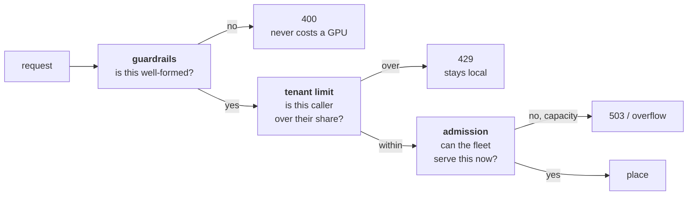

# Part 3 — Guardrails, admit, stay vs leave

Three gates, in order, each answering a different question. The order is the
design: the cheapest check runs first, and a refusal never costs a GPU.

## Guardrails — reject malformed at the door

`cluster/app/guardrails.py`. Model is in the allowlist, token limit is sane, the
payload is a chat completion. Returns 400 and the reason, having touched nothing
expensive.

The allowlist carries `text` and `vision` aliases resolving to `TEXT_MODEL` and
`VISION_MODEL`. For this project only the text path is used; the vision alias is
left in place rather than deleted because it is the ODSC extension point.

A guardrail refusal is **not** in the admission decision log. It says nothing
about capacity, and mixing it in would inflate the refusal count with rejections
the policy never saw.

## Tenant limit — a quota refusal, before capacity is consulted

Runs **before** admission, and the ordering is load-bearing in two directions:

- A quota refusal is client-attributable, so it is a **429**, and a 429 must
  **never** reach the paid overflow provider. Paying for a request we are
  refusing on policy grounds is overspending, not a capacity event.
- Asking the capacity question first would charge a over-quota tenant's request
  against the fleet's pressure reading before deciding it was never going to be
  served.

## Admission — a socket, not a rule

Runs **after** the tenant limit and **before** `router.place`, because choosing
among replicas is a different question from whether to serve at all.

The whole integration is `cluster/gateway/admitperf_gate.py`, so the rest of the
gateway never learns about AdmitPerf. Five lines reach into
`gateway/admission.py`; everything else is in that one file.

### The policy for this project

**`kv_threshold` with default 0.90.** One policy. Its five axes, declared at
registration, which is what fills in the report card:

| Axis | Value |
|---|---|
| Unit | request (not batch, not token) |
| Setting | online |
| Objective | deadline |
| Signal | kv-pressure |
| Portability | **Class A** — a pure function of request and state, no engine changes |

Class A matters practically: a policy that needs changes inside vLLM's scheduler
cannot sit behind this interface, and finding that out halfway through porting
one wastes the effort.

### Why not compare four policies

Naming a winner needs a stronger sweep than one cluster can support. Comparing
policies is follow-on work.

One exception, cheap enough to be worth it: a **`queue_depth` run as a sanity
check that the report generator is policy-generic**. It is one environment
variable and it proves the socket is not secretly `kv_threshold`-shaped. It is
not a comparison and the report will not present it as one.

### The baseline is `no_admission`, not the gate switched off

With the gate off nothing is logged, so there would be no baseline report to
compare against — the comparison would have one side. `no_admission` admits
everything and records each decision with the metrics behind it, which gives the
baseline the same shape of log as any other run.

### The signal AdmitPerf reads

Under vLLM's own metric names, not the gateway's, because a signal is only
comparable across deployments if every host reports the same quantity under the
same name.

| AdmitPerf signal | Scraped from |
|---|---|
| `kv_pressure` | `vllm:kv_cache_usage_perc`, from the replica with the most headroom |
| `queue_depth` | `vllm:num_requests_waiting`, **summed** across the fleet |
| `running` | `vllm:num_requests_running`, summed |

Pressure is a max-headroom reading and queue depth is a sum, and the asymmetry is
deliberate. Pressure asks "is there anywhere good to send this", which is about
the best replica. A queue is work the fleet owes and it is spread, so it adds up.

## Stay vs leave

| Refusal | Code | Leaves the cluster? |
|---|---|---|
| Malformed request | 400 | no |
| Tenant over quota | 429 | **never** |
| Fleet genuinely full | 503 | yes, up to `OVERFLOW_MAX_REQS` |
| Upstream overloaded | 529 | yes, same cap |

`d.status` is derived from the reason by AdmitPerf — 503 for capacity, 429 for
client-attributable causes — so the refusals are comparable with anyone else's
without us choosing a convention.

Two things about overflow worth writing down rather than assuming:

- A smaller model answering in place of the 32B is a **relief valve, not
  equivalent service.** Overflowed responses are not pooled with local ones when
  reporting anything about quality.
- The cap is a lifetime count, not a rate. See
  [Part 2](02-cluster.md#the-settings-and-why).

## What the decision log holds

One row per admission decision. The column that does not usually exist elsewhere
is the fourth one.

| Field | Why |
|---|---|
| `ts`, `request_id` | joins to the outcome, and to vLLM's own traces |
| `policy`, `params` | parameter provenance, reporting item 5 |
| **`signal`, `value`** | **what the policy actually saw.** The column that usually does not exist |
| `verdict`, `reason` | admit / defer / reject, and why |
| `status` | derived from the reason, so refusals are comparable |

`Gate.outcome()` writes a second row for what happened to an admitted request.
Without it the log holds decisions and no consequences, so a report can say what
the policy *did* but not what it *bought*. The join is on `request_id`.

## Failure modes in the gate itself

From the comments in `admitperf_gate.py`, because each one produces a report that
looks fine and is wrong:

| Mode | What the report would look like | Guard |
|---|---|---|
| A scrape fails and the metric is zeroed | Every request admitted, signal flat at 0 — identical to an inert policy | Missing values are **omitted**, never zeroed |
| The log path is unwritable | Policy decides, records nothing; empty report reads as "never fired" | Falls back to `log=None` and sets `admitperf_gate_recording 0` |
| `admitperf` not installed in the image | Report claims a policy that never loaded | `admitperf_gate_active 0` with a named reason |
| A bad parameter | A default silently substituted, measuring something nobody asked for | Refuses to construct; the gateway says why |
| Run ends without `close()` | Loses the last few decisions — including the saturation event | `close()` flushes; called on shutdown |

The policy **fails open**: a policy that raises admits, because failing closed on
a bug sheds all traffic. That is the right default and it has a cost — a policy
crashing on every call is indistinguishable from `no_admission` in the outcome,
which is why `admitperf_gate_active` is a separate metric from the decision log.
