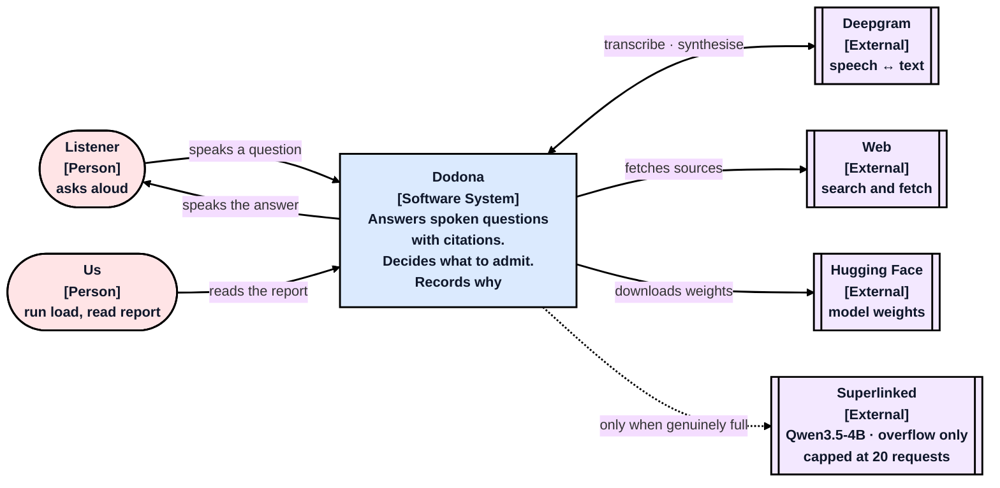
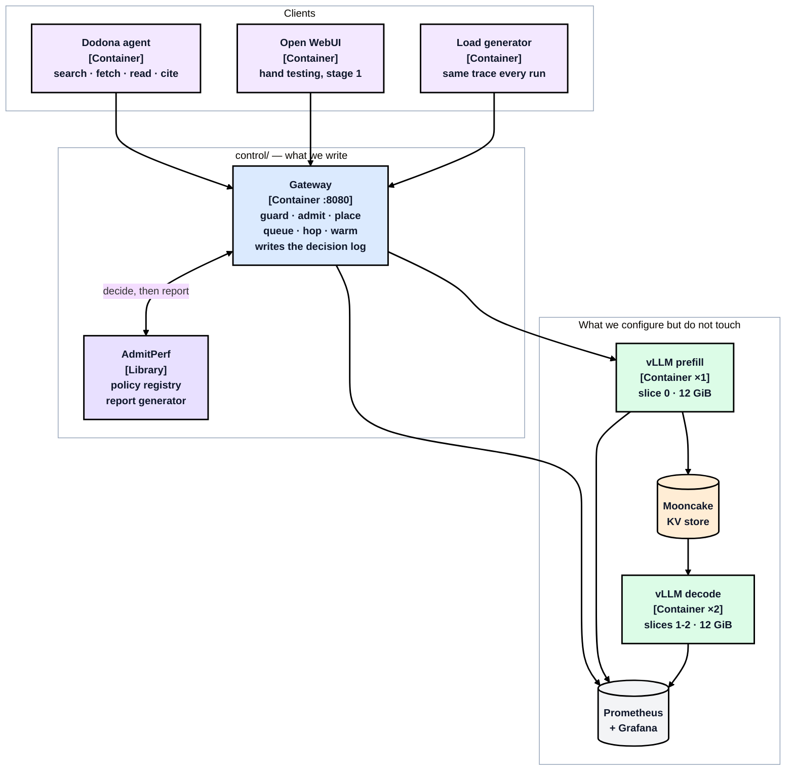
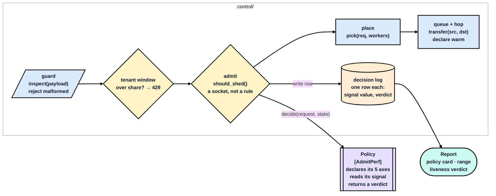

# Architecture — the C4 levels

The system from outside, then the pieces it is made of, then inside the piece we
write. The single high-level view lives in
[`../../README.md`](../../README.md#architecture); these are the levels beneath it.
The [C4 model](https://c4model.com): the system from outside, then the pieces,
then inside the piece we write. The single high-level view is in
[`../../SUBMISSION.md`](../../SUBMISSION.md#high-level); these are the levels beneath it.

### Level 1 — Context

The dotted line is the only exit from the cluster and it is for capacity failures
alone. A tenant refusal stays local — a caller over their own quota being served
on capacity we pay for is overspending, not a capacity problem.

Deepgram is solid-line and external on purpose: speech is in the request path but
**off the GPU**, so it is a network constant rather than something competing for
SM time.

### Level 2 — Containers

**Open WebUI comes before the agent** — stage 1 points it straight at the engine
for hand testing, so a broken agent and a broken gateway are never confused for
each other. The load generator exists for the one thing it is good at: replaying
the *same* trace so two runs can be compared.

### Level 3 — Inside the gateway

Admission reads what the workers are doing, hands that plus the request to a
policy from the registry, does what comes back, and writes one row. The policy
declares its five axes at registration — unit, setting, objective, signal,
portability — so the report card fills itself in.

**The tenant window sits before admission**, and the ordering is load-bearing:
a quota refusal is client-attributable, so it is a 429, and a 429 must never
reach the paid overflow provider.

---
