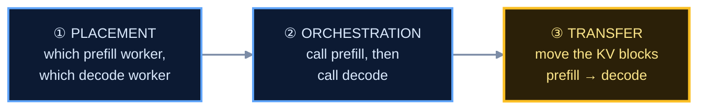

# Topology — what prefill/decode disaggregation actually requires

Written because the fleet is labelled `1 prefill + 2 decode` and the question
"so how are they talking?" did not have a good answer. This works out what a
split actually needs, what our code does, what the lab modules did, how llm-d
does it, and what our options are.

**Confidence note.** Everything about our own code is verified by reading it,
and quoted. Everything about vLLM's connectors is from its configuration
surface. The llm-d section is the least certain and is marked where it is.

---

## 1. Why split prefill from decode at all

The two phases of a request want opposite things from a GPU.

| | prefill | decode |
|---|---|---|
| work | one forward pass over the whole prompt | one token at a time, autoregressive |
| bound by | **compute** — big dense matmuls | **memory bandwidth** — reading the KV cache |
| duration | ~1 s for 12k tokens | tens of ms per token, for hundreds of tokens |
| KV | **builds** it, then it is no longer needed *there* | **holds** it for the whole generation |

Run them on the same worker and they interfere. A 12k-token prefill occupies the
GPU for about a second, and every sequence currently decoding on that worker
stalls for that second. Users experience it as the answer stuttering whenever
somebody else asks a long question.

Splitting puts prefills on one set of workers and generations on another, so a
long prefill cannot stall anybody's decode loop. **That is the entire argument.**
It is about interference, not throughput — disaggregating usually *lowers* total
concurrency, because the model weights are now resident in more places.

---

## 2. A real split needs three separate things

This is the part that was muddled, and the reason the question was hard to
answer.



**① Placement** — a router decides *which* prefill worker and *which* decode
worker. Pure scheduling. Lives in the control plane.

**② Orchestration** — something calls prefill, then calls decode. Usually a
proxy. Also control plane.

**③ Transfer** — the KV blocks prefill produced have to **be where decode will
read them**. This is the one that cannot be faked, and it lives **inside the
engine**. vLLM owns the block table; nothing outside the process can hand blocks
to another process by writing a JSON record about it.

> **Miss ③ and the split is worse than not splitting.** Decode has no blocks, so
> it re-prefills the whole prompt. You have now done the prefill twice, on two
> different GPUs, to produce one answer.

---

## 3. What our code actually does

### Orchestration — real, and exactly as expected

`control/gateway/queue.py`:

```python
if handoff.decode is handoff.prefill:
    out = handoff.prefill.enqueue(req, phase="both")     # same pod → no hop
    return None, out
out_p = handoff.prefill.enqueue(req, phase="prefill")     # 1. prefill
hop   = bus.transfer(prefill.id, decode.id, req)          # 2. the bus
out_d = handoff.decode.enqueue(req, phase="decode")       # 3. decode
```

Three steps, and the `src == dst` short-circuit the brief asks for. ✅

### Placement — real

`control/router/router.py` picks both ends with different scorers — prefill on
prefix-cache locality, decode on load. ✅

### Transfer — **bookkeeping, not bytes**

`control/router/kvbus.py`:

```python
def transfer(self, src: str, dst: str, req: Request) -> dict:
    tokens = self.cached(src, req.prefix_hash) or int(req.prompt_tokens)
    if req.prefix_hash:
        self.record(dst, req.prefix_hash, tokens)   # dst now CLAIMS this prefix
    hop = {"src": src, "dst": dst, "tokens": tokens, ...}
    self.hops.append(hop)
    METRICS.inc_kv_transfer(tokens)
    _backend_put(hop)                                # POST the record to the store
    return hop
```

It records that a hop happened and re-registers the prefix against the
destination, so the *next* placement decision is prefix-aware. No blocks move.
The lab's own `docs/cluster/kvbus.md` says so in its opening line — *"why it is
inert against real vLLM"* — and that `KVBus` is "the router's **bookkeeping** of
which... not the KV cache itself — vLLM owns that."

So ① and ② are real; ③ is not implemented.

### And a second gap, in the worker

There are two worker classes. `FakeWorker` honours `phase` properly — separate
`_prefill_left` / `_decode_left`, `SliceOOM` when the slice is full. The
simulation is faithful.

`VLLMWorker` — the one that talks to a real engine — **ignores `phase`
entirely**:

```python
def enqueue(self, req, phase="both"):
    payload = {"model": …, "messages": …, "max_tokens": max(1, int(req.max_new_tokens))}
```

`phase` is accepted and never read. Against real vLLM both legs send the same
full request, so the prefill worker generates a complete answer which is then
**discarded** (`completion = out_d`). That is not a hop; it is the whole request
done twice.

This is identical in the upstream lab modules and here — the files are byte-for-byte
the same. **No module has ever run this path against real vLLM**, which is
consistent with `kvbus.md` calling it inert.

---

## 4. What the lab modules had

Checked directly:

| | 9b | 10 | Dodona |
|---|---|---|---|
| `--kv-transfer-config` anywhere | none | none | none |
| `router/mooncake.py` | 78 lines | identical | identical |
| what it is | a Python HTTP server with `put` / `/hops` / `/metrics` | same | same |
| deployed as | `image: python:3.12-slim` | same | not deployed |

"Mooncake" in this lab lineage is **a 78-line hop recorder**, not the Mooncake
transfer engine. `mooncake.yaml` names `mooncake-transfer-engine:lab`, an image
that has to be built locally and which we do not have — but `hami-lambda.yaml`
ran the Python version, and that is what was working in the cohort.

**So what you saw working was working.** The hop records, the `/hops` panel, the
prefix-aware placement, the warmth checks — all real. What never happened is a KV
block crossing between pods.

---

## 5. How vLLM does the real thing

`--kv-transfer-config` on both sides, with a role and a connector:

```
prefill:  --kv-transfer-config '{"kv_connector":"...","kv_role":"kv_producer"}'
decode:   --kv-transfer-config '{"kv_connector":"...","kv_role":"kv_consumer"}'
```

| connector | transport | fit for one node |
|---|---|---|
| `SharedStorageConnector` | a filesystem both pods mount | **best** — a `hostPath`, no extra service |
| `LMCacheConnectorV1` | LMCache, CPU/disk tiers | works, adds a component |
| `NixlConnector` | NIXL, RDMA/TCP | what llm-d uses; most setup |
| `P2pNcclConnector` | NCCL point-to-point | heavier |

The proxy still does `max_tokens=1` to prefill, then the full request to decode —
**that part of my earlier suggestion was right**. What makes it work is the
connector underneath: decode's `kv_consumer` finds the blocks and starts
generating from token 1 instead of re-prefilling.

`max_tokens=1` **without** a connector is the harmful case in §2: prefill once on
one GPU, prefill again on the other.

---

## 6. How llm-d does it

> **Lower confidence.** The shape is clear; the exact request flow should be
> checked against llm-d's docs before we cite it anywhere.

llm-d separates the two concerns cleanly:

| | |
|---|---|
| **Placement** | the **EPP** (endpoint picker) behind the Gateway API Inference Extension — `InferencePool` + `endpointPickerRef`. Scores endpoints on prefix-cache locality, KV pressure, load |
| **Transfer** | **NIXL**, via vLLM's own `--kv-transfer-config`. The router never touches KV |

The design point worth taking: **the router only picks; the engines move the KV
themselves.** Our `kvbus` sits in a third position that neither has — a router
that *records* a transfer it does not perform.

Those `InferencePool` and `endpointPickerRef` manifests in the vendored tree are
llm-d's placement half. We removed them deliberately, as too much new
infrastructure for the timeline.

---

## 7. Our options

| | what it means | cost | Part 6 satisfied by |
|---|---|---|---|
| **A. Colocated, documented honestly** | three replicas, no split. Keep `kvbus` for prefix-aware placement | nothing — the fleet already works | the **warmup proof**. The brief says "hop-**or**-warmup" |
| **B. `SharedStorageConnector`** | real blocks, via a `hostPath` both pods mount | `--kv-transfer-config` + a volume + `VLLMWorker` honouring `phase` | a **real hop**, with a measured transfer time |
| **C. `NixlConnector` + EPP** | what llm-d does | days | a real hop, production-shaped |

**A pays immediately.** `vllm-prefill` currently holds 10.6 GiB and has served
zero requests — `prompt_tokens_total = 0`. Routing across all three replicas
takes the decode pool from 9.8 to ~14.6 concurrent sequences, which also helps
the saturation problem: 32 agent sessions peaked at 0.54 KV usage, well short
of the 0.90 an admission policy needs to fire.

**B is the one that makes the documents true.** Part 6's recompute-vs-transfer
comparison is currently a fiction — it compares against a transfer that does not
happen. With B it becomes a measurement.

**C is the right answer for a production system and the wrong one for this
deadline.** Worth naming in `PROJECT.md` as the next version.

### What would have to change for B

1. `--kv-transfer-config` on both deployments, with matching `kv_role`
2. a `hostPath` volume both pods mount
3. `VLLMWorker.enqueue` to honour `phase` — `max_tokens=1` for the prefill leg
4. a test that the prefill leg sends `max_tokens=1` and the decode leg does not
5. measure: transfer time, and decode's prefix-cache hit rate with and without

Step 3 is required for B and **harmful without it**, so it must not be done
alone.

---

## 8. What this changes in the documents

Regardless of which option:

- **Part 6's economics are wrong as written.** "recompute ~2.5–3.7 s vs move
  ~0.5–0.8 s" compares against a transfer that does not occur.
- **"Mooncake is the only backend that actually moves bytes"** — in
  `SUBMISSION.md` Part 6 and `.env.example` — is false. It is a 78-line hop
  recorder. `nccl.py` and `nixl.py` being stubs is true; the implication that
  Mooncake is not one is not.
- **The README diagram draws `prefill → Mooncake → decode`.** Under A that edge
  has to go or be relabelled as a bookkeeping record.
